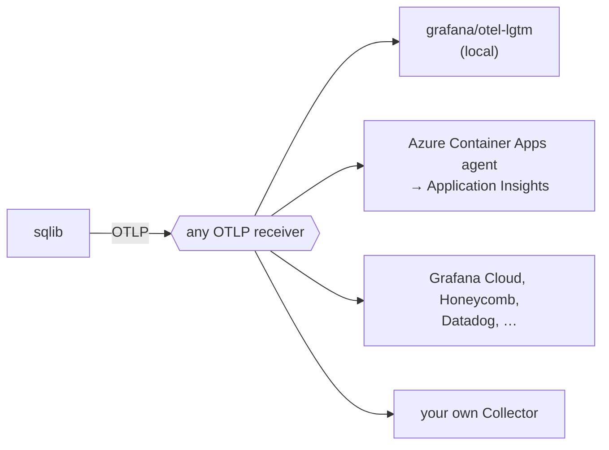

# Observability

sqlib sends traces, metrics and logs with OpenTelemetry, over OTLP. It has no
exporter for a specific vendor. To send telemetry, set the standard `OTEL_*`
variables to an OTLP receiver. Until you do this, telemetry is off.



The variables are listed in the
[configuration reference](../reference/configuration.md#telemetry).

## What is sent

**Traces.** One trace per HTTP request:

- the server span, and the Fastify spans under it (route, hooks, handler);
- a client span for each call to a SPARQL backend, with `url.full` and the
  status code;
- on `/execute`, the handler span carries the run: `sqlib.target.id`,
  `sqlib.version.id`, `sqlib.environment`, `sqlib.backend.id`,
  `sqlib.backend.type`, `sqlib.result.rows` and `sqlib.run.status`.

sqlib uses an incoming `traceparent` header, so the trace of a caller
continues into sqlib.

**Metrics.** HTTP server and client request duration (OpenTelemetry semantic
conventions), `query.execution.count` and `query.execution.duration` by
backend and status, `authz.decision.count`, and the cache and Oxigraph gauges.

**Logs.** Each log line goes to stdout. With telemetry on, it also goes out as
an OTLP log record, unless `OTEL_LOGS_EXPORTER=none`. A line logged in a
request has `trace_id` and `span_id`, also on stdout.

sqlib sends query text and argument values only when `SQLIB_TELEMETRY_DETAIL`
allows it.

## Slow query log

A run of `/execute` that takes `SQLIB_SLOW_QUERY_MS` (default 1000) or longer
writes one warning line with `event: "sqlib.query.slow"`:

```json
{
  "level": 40,
  "event": "sqlib.query.slow",
  "targetId": "urn:sqlib:query:5f18…",
  "targetType": "Query",
  "versionId": "urn:sqlib:query-version:656d…",
  "environment": "prod",
  "backendId": "urn:sqlib:backend:fuseki",
  "backendType": "http",
  "status": "success",
  "durationMs": 1840.2,
  "backendDurationMs": 1790.6,
  "rowCount": 12000,
  "thresholdMs": 1000,
  "trace_id": "71651b2ba2a3f4a3d8e080162ec4b4a9",
  "msg": "Slow query run: urn:sqlib:query:5f18… took 1840 ms"
}
```

The line is an ordinary log line, so it is also written when telemetry is off.
One filter finds the slow runs:

| Where the logs are | Query |
| --- | --- |
| Loki | `{service_name="sqlib"} \| event="sqlib.query.slow"` |
| Application Insights / Log Analytics (OTLP logs) | `traces \| where customDimensions.event == "sqlib.query.slow"` |
| Container stdout in Log Analytics | `ContainerAppConsoleLogs_CL \| where Log_s has "sqlib.query.slow"` |

`SQLIB_TELEMETRY_DETAIL` sets what else the line contains:

| Value | Adds |
| --- | --- |
| `ids` (default) | Nothing. With the version IRI, a reader can fetch the text from sqlib, with the access of that reader. |
| `text` | `queryText`: the saved text, before arguments are bound. |
| `text+args` | Also `arguments` and `argumentSetIds`, as the caller sent them. These can hold private values. |

A common configuration is `text+args` in development and `ids` in production.

An assistant can analyse slow runs. Give it access to the log store and to
sqlib. It can then:

1. read the slow lines;
2. fetch the text of each version through the sqlib MCP server;
3. open the trace for the backend timing;
4. run the query again in the Bench, with the same arguments.

## Local: grafana/otel-lgtm

`docker-compose.dev.yml` runs `grafana/otel-lgtm`, one container with an
OpenTelemetry Collector, Tempo, Loki, Prometheus and Grafana, and provisions a
"sqlib" dashboard from `infrastructure/observability/`.

```bash
just dev-otel        # start the stack, then `just dev` sending telemetry to it
# or
just lgtm-up         # start the stack only
OTEL_EXPORTER_OTLP_ENDPOINT=http://localhost:4318 just dev
just lgtm-down
```

Grafana is at <http://localhost:3030>, with no login. The dashboard shows:

- request rate and latency by route;
- query runs and their duration by backend;
- SPARQL backend call latency;
- cache memory;
- the slow query lines;
- recent `/execute` traces, and error lines.

The data is in memory, and is lost when the container stops.

`just dev-otel` sets `SQLIB_SLOW_QUERY_MS=200` and
`SQLIB_TELEMETRY_DETAIL=text+args`, unless you set them yourself.

The same container works with a self-hosted sqlib. Run it next to the sqlib
container, and set `OTEL_EXPORTER_OTLP_ENDPOINT=http://<lgtm host>:4318` on
sqlib.

## In the app

Administrators see a Telemetry section at the end of Settings. It shows:

- the state: Off, Exporting, or Failing when an export failed in the last five
  minutes (with the last error);
- the service name and the OTLP endpoint host;
- the slow runs since the server started, and when the last one was;
- an "Open dashboard" link, when `SQLIB_OBSERVABILITY_URL` is set.

`GET /telemetry` gives the same data, to administrators only. The counts are
for one process, and start again at zero on a restart. The log store has the
full history.

When `SQLIB_TRACE_URL_TEMPLATE` is set, each run result in the app has a trace
icon that opens the trace of that run. The server fills in `{traceId}`, and
sends the link in the `Sqlib-Trace-Url` response header, so other clients can
also use it. Examples:

```bash
# Grafana with a Tempo datasource whose uid is "tempo" (the lgtm stack)
SQLIB_TRACE_URL_TEMPLATE='https://grafana.example/explore?schemaVersion=1&panes=%7B%22a%22%3A%7B%22datasource%22%3A%22tempo%22%2C%22queries%22%3A%5B%7B%22refId%22%3A%22A%22%2C%22datasource%22%3A%7B%22type%22%3A%22tempo%22%2C%22uid%22%3A%22tempo%22%7D%2C%22queryType%22%3A%22traceql%22%2C%22query%22%3A%22{traceId}%22%7D%5D%7D%7D'
# Jaeger
SQLIB_TRACE_URL_TEMPLATE='https://jaeger.example/trace/{traceId}'
# Honeycomb
SQLIB_TRACE_URL_TEMPLATE='https://ui.honeycomb.io/<team>/environments/<env>/trace?trace_id={traceId}'
```

`just dev-otel` sets both for the local stack.

## Recipes

Each recipe is configuration only.

**Azure Container Apps.** Configure the managed OpenTelemetry agent of the
environment with a destination. Application Insights takes traces and logs,
and no metrics. Datadog and OTLP endpoints take all three. The agent adds the
`OTEL_EXPORTER_OTLP_*` variables to each app. On the app, set
`OTEL_SERVICE_NAME`, and leave `OTEL_ENABLED` unset or `true`.

**Grafana Cloud.**

```bash
OTEL_EXPORTER_OTLP_ENDPOINT=https://otlp-gateway-<zone>.grafana.net/otlp
OTEL_EXPORTER_OTLP_HEADERS="Authorization=Basic <base64 of instance-id:token>"
```

**Honeycomb.**

```bash
OTEL_EXPORTER_OTLP_ENDPOINT=https://api.honeycomb.io
OTEL_EXPORTER_OTLP_HEADERS="x-honeycomb-team=<api key>"
```

**Jaeger, or another receiver without logs.** Turn log export off. Otherwise,
each export logs a warning:

```bash
OTEL_EXPORTER_OTLP_ENDPOINT=http://jaeger:4318
OTEL_LOGS_EXPORTER=none
```

**Your own Collector.** Send sqlib telemetry to it, and do fan-out, sampling or
attribute redaction there.

## Cost

Most of the volume comes from traces and logs. Metrics add little. To reduce
the volume:

- sample traces: `OTEL_TRACES_SAMPLER=parentbased_traceidratio`,
  `OTEL_TRACES_SAMPLER_ARG=0.2`;
- send logs by one path only. On a platform that already collects stdout, set
  `OTEL_LOGS_EXPORTER=none`, or keep OTLP logs and stop the collection of
  stdout;
- leave `SQLIB_TELEMETRY_DETAIL` at `ids`.

## Startup

With telemetry off, sqlib does not import the SDK. This saves about 220ms of a
cold start. With telemetry on, `cli.ts` of the MCP server starts the SDK before
any server module loads. The Fastify and HTTP instrumentation therefore see the
app in each transport mode.
