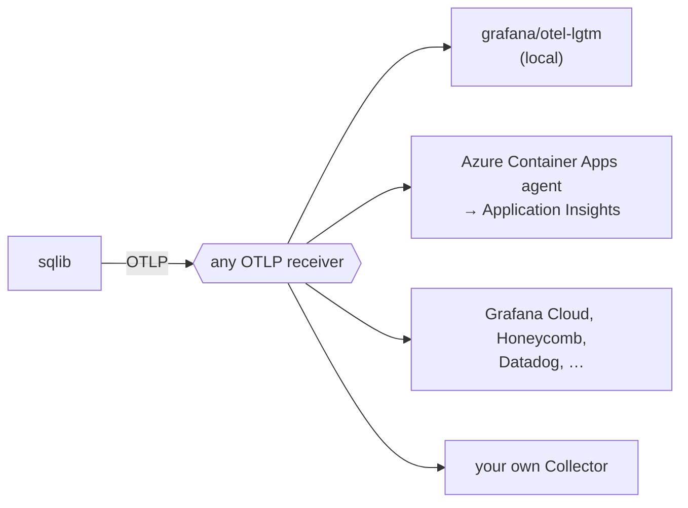

# Observability

sqlib sends traces, metrics and logs with OpenTelemetry, over OTLP. It has no
exporter of its own for any vendor: point it at any OTLP receiver with the
standard `OTEL_*` variables. Telemetry is off until you do.



The variables are listed in the
[configuration reference](../reference/configuration.md#telemetry).

## What is sent

**Traces.** One trace per HTTP request:

- the server span, and the Fastify spans under it (route, hooks, handler);
- a client span for every call to a SPARQL backend, with `url.full` and the
  status code;
- on `/execute`, the handler span carries the run: `sqlib.target.id`,
  `sqlib.version.id`, `sqlib.environment`, `sqlib.backend.id`,
  `sqlib.backend.type`, `sqlib.result.rows` and `sqlib.run.status`.

An incoming `traceparent` header is honoured, so a caller's trace continues
into sqlib.

**Metrics.** HTTP server and client request duration (OpenTelemetry semantic
conventions), `query.execution.count` and `query.execution.duration` by
backend and status, `authz.decision.count`, and the cache and Oxigraph gauges.

**Logs.** Every log line still goes to stdout. With telemetry on it also goes
out as an OTLP log record, unless `OTEL_LOGS_EXPORTER=none`. A line logged
inside a request carries `trace_id` and `span_id`, on stdout too.

Query text and argument values are not sent unless `SQLIB_TELEMETRY_DETAIL`
says so.

## Slow query log

A run of `/execute` that takes `SQLIB_SLOW_QUERY_MS` (default 1000) or longer
writes one warning line with `event: "sqlib.query.slow"`:

```json
{
  "level": 40,
  "event": "sqlib.query.slow",
  "targetId": "urn:sqlib:query:5f18…",
  "targetType": "Query",
  "versionId": "urn:sqlib:query-version:656d…",
  "environment": "prod",
  "backendId": "urn:sqlib:backend:fuseki",
  "backendType": "http",
  "status": "success",
  "durationMs": 1840.2,
  "backendDurationMs": 1790.6,
  "rowCount": 12000,
  "thresholdMs": 1000,
  "trace_id": "71651b2ba2a3f4a3d8e080162ec4b4a9",
  "msg": "Slow query run: urn:sqlib:query:5f18… took 1840 ms"
}
```

The line is an ordinary log line, so it is there with telemetry off as well.
Find the slow runs with one filter:

| Where the logs are | Query |
| --- | --- |
| Loki | `{service_name="sqlib"} \| event="sqlib.query.slow"` |
| Application Insights / Log Analytics (OTLP logs) | `traces \| where customDimensions.event == "sqlib.query.slow"` |
| Container stdout in Log Analytics | `ContainerAppConsoleLogs_CL \| where Log_s has "sqlib.query.slow"` |

`SQLIB_TELEMETRY_DETAIL` decides what else the line carries:

| Value | Adds |
| --- | --- |
| `ids` (default) | Nothing. The version IRI is enough to fetch the text from sqlib, with the caller's own access. |
| `text` | `queryText`: the saved text, before arguments are bound. |
| `text+args` | Also `arguments` and `argumentSetIds`, as the caller sent them. These can hold private values. |

A common split is `text+args` in development and `ids` in production.

To have an assistant analyse slow runs, give it the log store and sqlib: it
reads the slow lines, fetches each version's text through the sqlib MCP server,
opens the trace for the backend timing, and can re-run the query in the Bench
with the same arguments.

## Local: grafana/otel-lgtm

`docker-compose.dev.yml` runs `grafana/otel-lgtm`, one container with an
OpenTelemetry Collector, Tempo, Loki, Prometheus and Grafana, and provisions a
"sqlib" dashboard from `infrastructure/observability/`.

```bash
just dev-otel        # start the stack, then `just dev` sending telemetry to it
# or
just lgtm-up         # start the stack only
OTEL_EXPORTER_OTLP_ENDPOINT=http://localhost:4318 just dev
just lgtm-down
```

Grafana is on <http://localhost:3030>, with no login. The dashboard shows
request rate and latency by route, query runs and their duration by backend,
SPARQL backend call latency, cache memory, the slow query lines, recent
`/execute` traces and error lines. Data is in memory and is lost when the
container stops.

`just dev-otel` sets `SQLIB_SLOW_QUERY_MS=200` and
`SQLIB_TELEMETRY_DETAIL=text+args` unless you set them.

The same container works next to a self-hosted sqlib: run it beside the sqlib
container and set `OTEL_EXPORTER_OTLP_ENDPOINT=http://<lgtm host>:4318` on sqlib.

## Recipes

Every recipe is configuration only.

**Azure Container Apps.** Configure the environment's managed OpenTelemetry
agent with a destination (Application Insights takes traces and logs, not
metrics; Datadog and OTLP endpoints take all three). The agent injects the
`OTEL_EXPORTER_OTLP_*` variables into each app. On the app, set
`OTEL_SERVICE_NAME` and leave `OTEL_ENABLED` unset or `true`.

**Grafana Cloud.**

```bash
OTEL_EXPORTER_OTLP_ENDPOINT=https://otlp-gateway-<zone>.grafana.net/otlp
OTEL_EXPORTER_OTLP_HEADERS="Authorization=Basic <base64 of instance-id:token>"
```

**Honeycomb.**

```bash
OTEL_EXPORTER_OTLP_ENDPOINT=https://api.honeycomb.io
OTEL_EXPORTER_OTLP_HEADERS="x-honeycomb-team=<api key>"
```

**Jaeger, or another receiver without logs.** Turn log export off, or each
export logs a warning:

```bash
OTEL_EXPORTER_OTLP_ENDPOINT=http://jaeger:4318
OTEL_LOGS_EXPORTER=none
```

**Your own Collector.** Point sqlib at it and do fan-out, sampling or attribute
redaction there.

## Cost

Volume comes from traces and logs, not metrics. To keep it down:

- sample traces: `OTEL_TRACES_SAMPLER=parentbased_traceidratio`,
  `OTEL_TRACES_SAMPLER_ARG=0.2`;
- send logs one way only: on a platform that already collects stdout, set
  `OTEL_LOGS_EXPORTER=none`, or keep OTLP logs and stop collecting stdout;
- leave `SQLIB_TELEMETRY_DETAIL` at `ids`.

## Startup

With telemetry off the SDK is not imported, which saves about 220ms of a cold
start. With it on, the MCP server's `cli.ts` starts the SDK before any server
module loads, so the Fastify and HTTP instrumentation see the app in every
transport mode.
