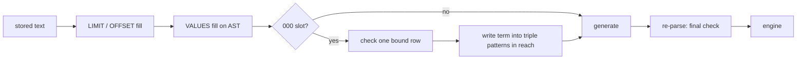

# Constant substitution: a minimal first version

Status: implemented, version 1, with the value pattern. Written 2026-10-26
against `proposals` at `2045fc5`; updated 2026-11-10 with the QLever test
results (see [Verification](#verification)).

Code: `packages/compiler/src/constantSlots.ts` (reach and positions),
`SparqlQueryParser.applyArguments` and `detectInputs` in
`packages/compiler/src/parser.ts`, and `SlotPolicy.valuePattern` in
`packages/runtime/src/query-template.ts`.

This document replaces two earlier designs, which are on the `proposals`
branch:

- Constant parameters (`constant-parameters.md`): declare with
  `VALUES ?000word { UNDEF }`, write the value at each occurrence.
- Direct variable substitution (`direct-variable-substitution.md`): declare
  with a `#! substitute ?word` pragma, replace on the AST, re-parse.

It keeps the `VALUES` declaration from the first, the AST rewrite and
re-parse from the second, and removes everything that a first version does
not need. The deferred items are listed at the end.

## The idea in one paragraph

A constant parameter **is a `VALUES` parameter**. It is declared, filled and
validated exactly like one. The only differences:

1. It must receive exactly one row.
2. After the normal `VALUES` fill, the runtime also writes the same
   serialised term into the triple patterns where the variable occurs.

The filled `VALUES` row stays in the query. So the variable stays bound,
and the query means the same thing with or without step 2. Step 2 only
changes which form the engine sees. It does not change the solutions.

## Why this is the clean form

- **No new declaration syntax.** `VALUES ?000word { UNDEF }` already parses,
  already appears in `detectInputs`, and already survives the formatter.
  A pragma needs formatter changes and makes one kind of comment meaningful.
- **No new wire shape.** The caller sends the same `arguments` document as
  for any `VALUES` slot. Saved argument sets and query group edges work
  unchanged.
- **No new term serialisation.** The constant is the term that
  `serializeTerm` already wrote into the `VALUES` row. There is one escaper
  and one trust boundary.
- **Same answers as a plain `VALUES` run.** Because the row stays, the
  variable is still in the solution. `SELECT ?000word`, `SELECT *`,
  `ORDER BY` and a `FILTER` beside the `VALUES` clause keep working. The
  earlier designs had to refuse these positions because the variable
  disappeared.
- **Testable by equivalence.** Run the query with and without step 2 on
  Oxigraph. The results must be equal. That is the whole correctness
  property.

## Example

Stored query:

```sparql
PREFIX ts: <https://qlever.cs.uni-freiburg.de/textSearch/>
SELECT ?entity ?000word WHERE {
  VALUES ?000word { UNDEF }
  SERVICE ts: {
    ?t ts:contains [ ts:word ?000word ] .
    ?t ts:contains [ ts:entity ?entity ] .
  }
}
```

Arguments:

```json
[{ "head": { "vars": ["000word"] },
   "results": { "bindings": [
     { "000word": { "type": "literal", "value": "copper*" } } ] } }]
```

Query sent to the engine:

```sparql
PREFIX ts: <https://qlever.cs.uni-freiburg.de/textSearch/>
SELECT ?entity ?000word WHERE {
  VALUES ?000word { "copper*" }
  SERVICE ts: {
    ?t ts:contains [ ts:word "copper*" ] .
    ?t ts:contains [ ts:entity ?entity ] .
  }
}
```

## Rules

### Declaration

- A constant parameter is a `VALUES … { UNDEF }` clause with **one**
  variable whose name starts with `000`.
- `VALUES (?000a ?b) { (UNDEF UNDEF) }` is refused. A multi-variable clause
  has no single term to write.
- A query that has no `000` variable behaves exactly as it does today.

### Values

| Case | Result |
| --- | --- |
| One row, cell bound, `uri` or `literal` | Accepted |
| Zero rows | 400, names the parameter |
| Two or more rows | 400, names the parameter |
| Cell is `UNDEF` | 400, names the parameter |
| Parameter omitted | 400, names the parameter |
| Blank node | 400, as today for every slot |

Omission is an error, not "unconstrained". An open variable in a position
that needs a constant fails at the engine anyway.

### Where the term is written

The runtime writes the term only into a **triple pattern** (subject,
predicate or object) that is in the **reach** of the `VALUES` clause.

Reach is the group that holds the `VALUES` clause, plus groups nested in it
through only these:

- a plain group `{ … }`
- a `GRAPH … { … }` body
- a `SERVICE … { … }` body
- a `UNION` branch

All of these are inner joins with the `VALUES` row. A constant in their
triple patterns gives the same solutions as the join.

So the `VALUES` clause must be in the same group as the triple patterns that
need the constant, or in a group above them, and not above a sub-`SELECT`
that holds them. In a query whose search sits in a sub-`SELECT` (the Prez
`CONSTRUCT` search, for example), put the `VALUES` clause inside the
sub-`SELECT`. A clause in the outer `WHERE` reaches nothing inside the
sub-`SELECT`: detection warns (`sub-SELECT`), and QLever then refuses the
query because `ts:word` still has a variable.

### Where the variable may occur

| Position | Action |
| --- | --- |
| The `VALUES` header that declares it | Filled with the row, kept |
| Triple pattern term in reach | Replaced by the constant |
| `FILTER` directly in the group that holds the `VALUES` clause | Kept as a variable |
| Projection, `ORDER BY`, `GROUP BY`, `HAVING`, `CONSTRUCT` and UPDATE templates | Kept as a variable |
| Anything else | Kept as a variable, with a **warning** |

"Anything else" includes `OPTIONAL`, `MINUS`, `LATERAL` and `EXISTS`
bodies, sub-`SELECT` bodies, `BIND`, a `FILTER` in a nested group, the
`GRAPH ?g` and `SERVICE ?s` names, triple terms, and a `WHERE` pattern
outside the group that holds the `VALUES` clause. A property path cannot
hold a variable (SPARQL paths contain only IRIs), so a path needs no row:
the subject and object of a path triple are ordinary triple positions.

This is a scoping matter, not a safety matter. No caller value reaches a
new position: the runtime writes the constant only into triple patterns in
reach, and every other occurrence stays a variable bound by the kept
`VALUES` row, as today. So validation and save **warn**, and do not refuse.
The warning names the position.

The warning is there because the answer can differ from a plain `VALUES`
run. Example:

```sparql
SELECT ?t WHERE {
  VALUES ?000w { UNDEF }
  { ?t ts:word ?000w . FILTER(STRLEN(?000w) > 2) }
}
```

The nested `FILTER` reads `?000w`, which the triple pattern beside it binds.
After the triple pattern takes the constant, nothing binds `?000w` inside
that group. The `FILTER` sees an unbound variable, and every row is
dropped. The query runs, and it returns nothing. The author sees the
warning when they save, so the empty result is not a surprise. To avoid
it, move the `FILTER` beside the `VALUES` clause, or use a second
`VALUES` parameter.

### Operations

- `SELECT`, `CONSTRUCT`, `ASK`, `DESCRIBE` and UPDATE: all supported, with
  the same rules.
- In an UPDATE, the constant is written only into triple patterns of the
  `WHERE` clause. The `INSERT` and `DELETE` templates keep the variable,
  which the kept `VALUES` row binds. This is no more reach than a `VALUES`
  parameter has today, which can already bind a graph name in a template.

### Paths

- **Server, AST path only.** A query with a constant parameter skips the
  template fast path. The runtime fills `VALUES` on the AST, writes the
  constants, generates the text and re-parses it.
- **Export.** `sqlib export` refuses a query with a constant parameter in
  version 1. The reason is size, not risk. The constant is the same
  `serializeTerm` output as a `VALUES` cell, so it is no more dangerous in a
  browser. But the browser runtime has no parser, so it cannot find the
  triple patterns in reach. A bundle would have to carry the occurrence
  spans, recorded and verified at export time. That is the template fast
  path work, deferred below.

## Processing order



Step F uses the term node that step C built for the `VALUES` row. It does
not serialise the value again.

## Security, compared with `VALUES` substitution

| Risk | Status in version 1 |
| --- | --- |
| Value breaks out of its term | Same as `VALUES`. One escaper, `serializeTerm`. The re-parse is a second check. |
| Value reaches a `SERVICE` endpoint, a `GRAPH` name or an UPDATE template as a constant | Not possible. Those positions keep the variable, bound by the `VALUES` row, as today. |
| Answer differs from the `VALUES` meaning through scope (`OPTIONAL`, sub-`SELECT`, nested `FILTER`) | Not a security risk. A warning at save names the position. |
| Engine reads the literal by its own grammar (QLever `*`, Virtuoso `bif:contains`) | **New exposure, accepted.** This is the reason for the feature. A `VALUES` value fed to `REGEX` has the same class of risk today. A value pattern is deferred. |
| Serialiser bug has a larger blast radius | Smaller than the earlier designs. The term lands only in a triple pattern, and the re-parse catches a structural change. |
| Browser runtime has no structural check | Does not apply in version 1. Export is refused, for size (see Paths). |

The sentence in [concepts](../concepts.md), "Argument values are never
concatenated into query text", stays true: the AST path writes a term node,
not text. `SECURITY.md` gets one added sentence: a `000` parameter is also
written as a constant into triple patterns.

## Changes needed

1. ~~`packages/runtime/src/sparql-terms.ts`: let `isSafeVariableName` accept a
   leading `000`.~~ Not needed in version 1. The check rejects `000word`, so
   these queries already take the AST path. It matters only once the
   template path or export supports constants, and both are deferred.
2. `packages/compiler/src/parser.ts`:
   - `detectInputs`: mark a one-variable `000` slot as `constant`. Refuse a
     multi-variable clause that holds a `000` variable. Warn on any
     occurrence in the "Anything else" row of the positions table.
   - `getVerifiedTemplate`: return `null` for a query with a constant slot,
     so it takes the AST path.
   - AST path: after the `VALUES` fill, check the row count, then walk the
     reach and replace the variable in triple patterns. For an UPDATE, walk
     only the `WHERE` clause.
3. `packages/types/src/parameterKeys.ts`: add the `constant` kind, or a flag
   on the existing table kind.
4. `sqlib export`: refuse a query with a constant slot, with a message.
5. `packages/web`: in the argument editor, show a constant slot as a
   single-value input. Not in this change; a second pull request.
6. Docs: [concepts](../concepts.md) (one section), `SECURITY.md` (one
   sentence).

No API, contract or bundle schema change, apart from the regenerated
`DetectedParameters`.

## Tests

- Equivalence: for a set of queries with a constant slot, the result with
  step F equals the result without it, on Oxigraph.
- Reach: one test for each nested form. A term is written in plain group,
  `GRAPH`, `SERVICE` and `UNION` bodies.
- Positions: one test for each row of the positions table. Each case in
  "Anything else" (`OPTIONAL`, `MINUS`, `EXISTS`, sub-`SELECT`, `BIND`,
  nested `FILTER`, `GRAPH` and `SERVICE` names, path elements) gives a
  warning that names the position, and the query still saves and runs.
- Values: each 400 case in the values table.
- Hostile values: reuse the table in `parser.injection.test.ts`. Each value
  is refused, or yields one term node in each written position.
- UPDATE: the constant is written in `WHERE` triple patterns only, and
  the templates keep the variable.
- Export with a constant slot is refused.

## Deferred

| Item | Why it can wait |
| --- | --- |
| Template fast path and export bundle support | Needs occurrence spans and verification probes. Constant queries are rare; one parse per run is acceptable. |
| Constants in expressions, `GROUP_CONCAT` separator | No known engine refuses a variable there. |
| Writing the constant in `OPTIONAL`, `MINUS`, `EXISTS`, sub-`SELECT`, `BIND`, nested `FILTER` | Version 1 keeps the variable there and warns. Writing the constant there needs a scope analysis. |
| Constants in `SERVICE ?endpoint`, `GRAPH ?g` names and UPDATE templates | No known engine needs a constant there. The variable works. |
| More than one value (a `UNION` per value) | Nothing needs it. |
| The `#! substitute` pragma | Replaced by the `000` prefix. Not needed. |

## Value pattern (in version 1)

The QLever test showed that a broad search word can stall a query: `relativ*`
in the Prez search did not finish in 2 minutes, because `?focus_node ?pred
?match` joins every matching entity. So version 1 has the value pattern.

- It is an optional regular expression on the slot's input tuple
  (`QueryInputTuple.valuePattern`), set through `inputPolicies` when a version
  is saved, beside `whenEmpty`. Like `whenEmpty`, it is carried to the next
  version until `null` clears it.
- Every bound value of the slot must match it, in Unicode mode, read against
  the lexical form or IRI. Anchors are the author's. A value that does not
  match is a 400 that names the value, the variable and the pattern.
- It applies to every slot, not only to constants, and on both substitution
  paths and in an exported bundle (`inputPolicies[].valuePattern`).
- A pattern that does not compile, or is longer than 200 characters, is
  refused at save.
- A minimum word length goes in the pattern. Example: letters and digits,
  at least four before an optional `*`: `^[\p{L}\p{N}]{4,}\*?$`.

It does not affect SPARQL safety, which `serializeTerm` gives. The pattern is
the query author's, so its cost on the server is the author's to keep small.

## Decisions

Settled with David on 2026-10-28:

1. **Marker:** `000` is the prefix.
2. **Scope cases** (nested `FILTER`, `OPTIONAL`, sub-`SELECT` and others)
   warn, and do not refuse.
3. **UPDATE** is supported. **Export** stays deferred, for size, not risk.

Settled on 2026-11-10:

4. **Value pattern** is in version 1 (above).
5. **The kept `VALUES` row is acceptable on QLever** with a text index
   (below).

## Verification

David ran a standalone prototype of step F against a local QLever
(`adfreiburg/qlever:commit-85564a5aba`), loaded with the scientists test
collection and a text index built from its text records and literals. Each
case ran with and without step F, and the sorted rows were compared.

| Case | Outcome |
| --- | --- |
| `ts:word ?000word` inside `SERVICE ts:` | 1,545 rows, identical to writing the word by hand. Without step F, QLever refuses the query: `The predicate <word> needs a literal as object`. |
| Prez `CONSTRUCT` search, `VALUES` inside the sub-`SELECT` | 41,289 triples, identical to writing `"einstein"` by hand |
| The same, `VALUES` in the outer `CONSTRUCT WHERE` | Warning, then the same QLever error |
| Text search in a `UNION` branch | Works |
| Plain triple pattern, nested group, `UNION`, `FILTER` beside the clause, property-path triple | Same rows with and without step F |
| `OPTIONAL`, `MINUS`, sub-`SELECT`, `BIND` | Same rows, each with a warning |
| `FILTER` in a nested group | 0 rows instead of 3,491, with a warning, as predicted |
| Hostile literal (`relativ*" ] . } } SELECT * …`) | Escaped into one literal in both positions; ran and returned 0 rows |
| Two rows, an `UNDEF` row, an omitted argument, a multi-variable clause | Each refused, naming the parameter |

Not covered there, and covered by the tests in this change on Oxigraph:
`GRAPH` reach, UPDATE, and equivalence on Oxigraph
(`packages/api/test/lib/constantSubstitution.oxigraph.test.ts`). The
`detectInputs` integration and save-time refusals are in
`packages/api/test/scenarios/query-groups/17-constant-parameter.test.ts`.

A side finding: the Prez query does not project `?pred` from its
sub-`SELECT`, so its `searchResultPredicate` triples come out empty. That is
the query's issue, not this feature's.

### Earlier check

The first question, before the local test, was whether the kept `VALUES`
row is acceptable on QLever. Partly checked
2026-10-26 on the public `qlever.dev/api/dblp` and
`qlever.dev/api/wikidata` endpoints. The combined form,
`VALUES ?000w { "copper*" }` with `ts:word "copper*"` in a `SERVICE ts:`
body, returns 200 with `head.vars` `["t", "000w"]`. The same query with
`ts:word ?w` still fails with `The predicate <word> needs a literal as
object`. Both endpoints return zero rows for any `ts:word` search, so
the rows themselves are not yet checked. That needs a QLever instance
with a text index.
