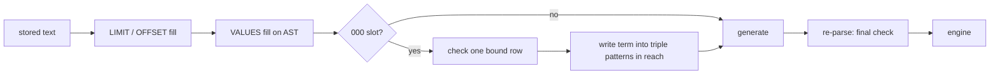

# Constant substitution: a minimal first version

Status: proposal, not implemented. Written 2026-10-26 against `proposals` at
`2045fc5`.

This document replaces the two earlier designs with one design:

- [Constant parameters](constant-parameters.md): declare with
  `VALUES ?000word { UNDEF }`, write the value at each occurrence.
- [Direct variable substitution](direct-variable-substitution.md): declare
  with a `#! substitute ?word` pragma, replace on the AST, re-parse.

It keeps the `VALUES` declaration from the first, the AST rewrite and
re-parse from the second, and removes everything that a first version does
not need. The deferred items are listed at the end.

## The idea in one paragraph

A constant parameter **is a `VALUES` parameter**. It is declared, filled and
validated exactly like one. The only differences:

1. It must receive exactly one row.
2. After the normal `VALUES` fill, the runtime also writes the same
   serialised term into the triple patterns where the variable occurs.

The filled `VALUES` row stays in the query. So the variable stays bound,
and the query means the same thing with or without step 2. Step 2 only
changes which form the engine sees. It does not change the solutions.

## Why this is the clean form

- **No new declaration syntax.** `VALUES ?000word { UNDEF }` already parses,
  already appears in `detectInputs`, and already survives the formatter.
  A pragma needs formatter changes and makes one kind of comment meaningful.
- **No new wire shape.** The caller sends the same `arguments` document as
  for any `VALUES` slot. Saved argument sets and query group edges work
  unchanged.
- **No new term serialisation.** The constant is the term that
  `serializeTerm` already wrote into the `VALUES` row. There is one escaper
  and one trust boundary.
- **Same answers as a plain `VALUES` run.** Because the row stays, the
  variable is still in the solution. `SELECT ?000word`, `SELECT *`,
  `ORDER BY` and a `FILTER` beside the `VALUES` clause keep working. The
  earlier designs had to refuse these positions because the variable
  disappeared.
- **Testable by equivalence.** Run the query with and without step 2 on
  Oxigraph. The results must be equal. That is the whole correctness
  property.

## Example

Stored query:

```sparql
PREFIX ts: <https://qlever.cs.uni-freiburg.de/textSearch/>
SELECT ?entity ?000word WHERE {
  VALUES ?000word { UNDEF }
  SERVICE ts: {
    ?t ts:contains [ ts:word ?000word ] .
    ?t ts:contains [ ts:entity ?entity ] .
  }
}
```

Arguments:

```json
[{ "head": { "vars": ["000word"] },
   "results": { "bindings": [
     { "000word": { "type": "literal", "value": "copper*" } } ] } }]
```

Query sent to the engine:

```sparql
PREFIX ts: <https://qlever.cs.uni-freiburg.de/textSearch/>
SELECT ?entity ?000word WHERE {
  VALUES ?000word { "copper*" }
  SERVICE ts: {
    ?t ts:contains [ ts:word "copper*" ] .
    ?t ts:contains [ ts:entity ?entity ] .
  }
}
```

## Rules

### Declaration

- A constant parameter is a `VALUES … { UNDEF }` clause with **one**
  variable whose name starts with `000`.
- `VALUES (?000a ?b) { (UNDEF UNDEF) }` is refused. A multi-variable clause
  has no single term to write.
- A query that has no `000` variable behaves exactly as it does today.

### Values

| Case | Result |
| --- | --- |
| One row, cell bound, `uri` or `literal` | Accepted |
| Zero rows | 400, names the parameter |
| Two or more rows | 400, names the parameter |
| Cell is `UNDEF` | 400, names the parameter |
| Parameter omitted | 400, names the parameter |
| Blank node | 400, as today for every slot |

Omission is an error, not "unconstrained". An open variable in a position
that needs a constant fails at the engine anyway.

### Where the term is written

The runtime writes the term only into a **triple pattern** (subject,
predicate or object) that is in the **reach** of the `VALUES` clause.

Reach is the group that holds the `VALUES` clause, plus groups nested in it
through only these:

- a plain group `{ … }`
- a `GRAPH … { … }` body
- a `SERVICE … { … }` body
- a `UNION` branch

All of these are inner joins with the `VALUES` row. A constant in their
triple patterns gives the same solutions as the join.

### Where the variable may occur

The variable may occur only in these positions. A query with any other
occurrence is refused when it is saved or validated, with an error that
names the position.

| Position | Action |
| --- | --- |
| The `VALUES` header that declares it | Filled with the row, kept |
| Triple pattern term in reach | Replaced by the constant |
| `FILTER` directly in the group that holds the `VALUES` clause | Kept as a variable |
| Outermost projection, `ORDER BY`, `GROUP BY`, `HAVING` | Kept as a variable |
| Anything else | Refused |

"Anything else" includes `OPTIONAL`, `MINUS` and `EXISTS` bodies,
sub-`SELECT` bodies, `BIND`, a `FILTER` in a nested group, the `GRAPH ?g`
and `SERVICE ?s` names, and property path elements.

The reason for the strict list: in a nested group, a `FILTER` or an
`OPTIONAL` that reads `?000word` relies on the triple pattern next to it to
bind the variable. After the triple pattern takes the constant, that
binding is gone, and the answer can change. The kept positions in the table
are evaluated after the `VALUES` join, so the variable is bound there.
A later version can open a refused position, with a scope analysis, when a
query needs it.

### Operations

- `SELECT`, `CONSTRUCT`, `ASK`, `DESCRIBE`: supported.
- UPDATE: a constant parameter is refused in version 1.

### Paths

- **Server, AST path only.** A query with a constant parameter skips the
  template fast path. The runtime fills `VALUES` on the AST, writes the
  constants, generates the text and re-parses it.
- **Export.** `sqlib export` refuses a query with a constant parameter in
  version 1. The browser runtime has no parser, and the bundle has no field
  for constant positions.

## Processing order



Step F uses the term node that step C built for the `VALUES` row. It does
not serialise the value again.

## Security, compared with `VALUES` substitution

| Risk | Status in version 1 |
| --- | --- |
| Value breaks out of its term | Same as `VALUES`. One escaper, `serializeTerm`. The re-parse is a second check. |
| Value reaches a `SERVICE` endpoint or a `GRAPH` name as a constant | Not possible. A query with the variable in those positions is refused. |
| Value reaches an UPDATE target | Not possible. Refused. |
| Value changes the answer through scope (`OPTIONAL`, sub-`SELECT`, nested `FILTER`) | Not possible. Those occurrences are refused, and the term is written only where it is equal to the join. |
| Engine reads the literal by its own grammar (QLever `*`, Virtuoso `bif:contains`) | **New exposure, accepted.** This is the reason for the feature. A `VALUES` value fed to `REGEX` has the same class of risk today. A value pattern is deferred. |
| Serialiser bug has a larger blast radius | Smaller than the earlier designs. The term lands only in a triple pattern, and the re-parse catches a structural change. |
| Browser runtime has no structural check | Not possible. Export is refused. |

The sentence in [concepts](../concepts.md), "Argument values are never
concatenated into query text", stays true: the AST path writes a term node,
not text. `SECURITY.md` gets one added sentence: a `000` parameter is also
written as a constant into triple patterns.

## Changes needed

1. `packages/runtime/src/sparql-terms.ts`: let `isSafeVariableName` accept a
   leading `000`. SPARQL's `VARNAME` allows a leading digit.
2. `packages/compiler/src/parser.ts`:
   - `detectInputs`: mark a one-variable `000` slot as `constant`. Refuse a
     multi-variable clause that holds a `000` variable, and any occurrence
     outside the positions table.
   - `getVerifiedTemplate`: return `null` for a query with a constant slot,
     so it takes the AST path.
   - AST path: after the `VALUES` fill, check the row count, then walk the
     reach and replace the variable in triple patterns.
   - Refuse a constant slot in an UPDATE.
3. `packages/types/src/parameterKeys.ts`: add the `constant` kind, or a flag
   on the existing table kind.
4. `sqlib export`: refuse a query with a constant slot, with a message.
5. `packages/web`: in the argument editor, show a constant slot as a
   single-value input.
6. Docs: [concepts](../concepts.md) (one section), `SECURITY.md` (one
   sentence).

No API, contract or bundle schema change, apart from the regenerated
`DetectedParameters`.

## Tests

- Equivalence: for a set of queries with a constant slot, the result with
  step F equals the result without it, on Oxigraph.
- Reach: one test for each nested form. A term is written in plain group,
  `GRAPH`, `SERVICE` and `UNION` bodies.
- Positions: one test for each row of the positions table, including each
  refusal (`OPTIONAL`, `MINUS`, `EXISTS`, sub-`SELECT`, `BIND`, nested
  `FILTER`, `GRAPH` and `SERVICE` names, path elements).
- Values: each 400 case in the values table.
- Hostile values: reuse the table in `parser.injection.test.ts`. Each value
  is refused, or yields one term node in each written position.
- UPDATE with a constant slot is refused. Export with a constant slot is
  refused.

## Deferred

| Item | Why it can wait |
| --- | --- |
| Value pattern on the input (for example `^[\p{L}\p{N}]+\*?$`) | Main mitigation for the engine's inner grammar. Add when a second engine or a public endpoint needs it. |
| Template fast path and export bundle support | Needs occurrence spans and verification probes. Constant queries are rare; one parse per run is acceptable. |
| Constants in expressions, property paths, `GROUP_CONCAT` separator | No known engine refuses a variable there. |
| The variable in `OPTIONAL`, `MINUS`, `EXISTS`, sub-`SELECT`, `BIND`, nested `FILTER` | The answer can differ from the join. Needs a scope analysis first. Use a second `VALUES` parameter for now. |
| `SERVICE ?endpoint`, `GRAPH ?g` names | Network and dataset targets. Refused. |
| UPDATE operations | Write targets. |
| More than one value (a `UNION` per value) | Nothing needs it. |
| The `#! substitute` pragma | Replaced by the `000` prefix. Not needed. |

## Open questions

1. **Is `000` the marker?** It follows `LIMIT 0001`. The alternative is a
   different prefix, so a reader cannot confuse a constant slot with a page
   parameter. Recommended: keep `000`.
2. **Is the kept `VALUES` row acceptable on QLever?** The example above has
   both `VALUES ?000word { "copper*" }` and `ts:word "copper*"`. The earlier
   test shows QLever accepts a `VALUES` block and a constant `ts:word`
   separately. The combined form needs one check before implementation.
