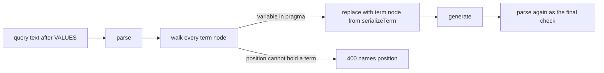

# Direct variable substitution (opt-in)

Status: proposed. Not implemented. Builds on the VALUES slot mechanism in
`packages/compiler/src/parser.ts` and the term serialiser in
`packages/runtime/src/sparql-terms.ts`.

## Problem

sqlib passes caller values into a query as rows of a `VALUES` block. That is
the right default. A `VALUES` row is data. It can never become query structure.

Some positions cannot take a `VALUES` binding. The engine needs a constant at
plan time, not a variable that a join binds later. Examples:

- QLever full-text search: `?text ql:contains-word "astro*"`. The object must
  be a literal. A variable bound by `VALUES` is refused.
- Wikidata's MediaWiki API service: `bd:serviceParam mwapi:search "term"`
  inside `SERVICE wikibase:mwapi { … }`. The service reads constants only.
- Virtuoso `bif:contains`, Neptune and Stardog full-text predicates, and most
  other vendor search extensions. Each takes a literal constant.

A query author who needs one of these has no supported way to parameterise
it. This proposal adds one. It is opt-in per query, and it is deliberately
small.

## The change in one paragraph

A query opts in with a pragma comment that names one or more variables. For
each named variable the caller supplies exactly one RDF term. sqlib replaces
every occurrence of that variable in the query with that term, serialised by
the same validator that renders `VALUES` rows, and then re-parses the result.
There are no arrays, no `UNDEF`, and no prefix abbreviation. A direct
parameter is required: a run that omits it is refused. Everything else about
the request stays as it is.

## Declaration

The author declares a direct parameter in the query text, next to the other
two declaration forms sqlib already has (`VALUES … { UNDEF }` and
`LIMIT 000n`):

```sparql
PREFIX ql: <http://qlever.cs.uni-freiburg.de/builtin-functions/>
#! substitute ?word

SELECT ?text ?score WHERE {
  ?text ql:contains-word ?word .
  ?text ql:contains-entity ?entity .
  ?entity <http://schema.org/name> ?name .
}
```

Rules:

- The pragma is a comment line that starts with `#! substitute`, followed by
  one or more variable names. A query may hold several pragma lines.
- A variable name must match the ASCII `VARNAME` that `sparql-terms.ts`
  already enforces: `[A-Za-z_][A-Za-z0-9_]*`.
- The named variable must occur in the query's code at least once. A pragma
  that names an absent variable is a validation error.
- The same name cannot be both a direct parameter and a `VALUES` slot
  variable. That is a validation error.
- A query with a pragma must still parse as written. The variable stays a
  variable until a run substitutes it. This restriction matters; see
  "What the grammar gives us" below.

Why a pragma and not a field on `QueryVersion`:

- The declaration travels with the text. It works for a saved version, for
  `POST /sparql` ad-hoc text, for SRL, and for an export.
- `detectInputs` already reads declarations out of the text. Clients call it
  rather than guess, and that stays true.
- The formatter must keep the pragma. `formatQueryString` already masks
  `LIMIT 000n` because Traqula's generator drops the lexeme. Comments are
  dropped the same way. The formatter must carry pragma lines through, by
  the same mask-and-restore step. This is a small change and it is the one
  real cost of the pragma form.

Alternative considered: a `directVariables: string[]` field on
`QueryVersion`. It needs no formatter change, but it does not reach `/sparql`
or exports, and it splits one declaration across two places. Rejected.

## Wire shape

A direct parameter is filled with the same document shape as a `VALUES` slot:
a SPARQL Results JSON document in `arguments`. It is matched by `head.vars`,
exactly as `assignArgumentSets` matches slots today.

```jsonc
{
  "targetId": "<query or version IRI>",
  "arguments": [
    { "head": { "vars": ["word"] },
      "results": { "bindings": [
        { "word": { "type": "literal", "value": "astro*" } }
      ] } }
  ]
}
```

Rules on top of the existing `arguments` contract:

| Rule | Detail |
| --- | --- |
| Arity | Exactly one row. Zero rows or two or more rows is a 400 that names the parameter. "No arrays" is a contract, not a limitation to work around. |
| Vars | `head.vars` holds exactly the one variable. A document that binds two direct parameters at once is refused. |
| Bound | The one cell is bound. An `UNDEF` cell is a 400. There is no wildcard. |
| Omission | A direct parameter that no document matches is a 400. It does not run unconstrained. |
| Terms | `uri` or `literal`, validated by `serializeTerm`. Blank nodes are refused, as today. |

Why reuse `arguments` instead of a new list beside `limits` and `offsets`:

- Every producer of arguments already emits this shape: the web app, the MCP
  server, the CLI, saved argument sets, and a query group edge that wires one
  query's rows into another's slot. A direct parameter fed from an upstream
  query row costs nothing extra.
- `detectInputs` gains one list, `directInputs: string[]`, and
  `parameterKeys.ts` gains one kind, `direct`. The fit, conflict and match
  questions are answered the same way for all three kinds.

Why omission is an error here but not for a `VALUES` slot: a `VALUES` slot
that runs unconstrained still means something. The join is open. A direct
parameter exists because the position needs a constant. A free variable there
either fails at the engine or silently changes what the query matches.
Refusing is the safe default. If a later need appears, a pragma option can
relax it.

## Application

Order of application in `invokeCallable` and `executionArguments`:

1. `LIMIT` / `OFFSET` substitution, as today.
2. `VALUES` substitution, as today. Template fast path or AST path.
3. Direct substitution, on the output of step 2.
4. Re-parse the result. A parse failure is a 400 that names the parameter.

Step 3 is implemented on the AST, not on the text, for version 1:



The term node is built the way `buildValuesTerm` builds one today: the value
goes through `serializeTerm` first, so it is validated, and the IRI is kept in
full `<…>` form with no prefix abbreviation.

Positions a variable can occupy, and what the walk does with each:

| Position | Action |
| --- | --- |
| Subject, predicate or object of a triple pattern, in `WHERE` or in a `CONSTRUCT` template | Replace. |
| Inside `GRAPH ?g { … }` as the graph name | Replace. |
| Inside an expression: `FILTER`, `BIND(… AS ?y)` source, `(… AS ?y)` source, function arguments | Replace. |
| `SELECT ?x` projection, `BIND(… AS ?x)` target, `GROUP BY ?x`, `ORDER BY ?x`, `VALUES` header | Refuse with a 400 that names the position. A constant cannot stand there. |
| `SERVICE ?endpoint { … }` endpoint | Refuse in version 1. See risk R1. |
| Any position in an UPDATE operation | Refuse in version 1. See risk R1. |
| Inside a string literal, a comment, or an IRI | Not a variable. The parser never sees one. Untouched. |

A textual fast path is possible later. It would record each occurrence's
span in the canonical text, as `buildTemplate` records `VALUES` spans, and it
would be verified against the AST path on probe values, as `verifyTemplate`
does today. It is not in version 1. Direct mode is opt-in and rare, and the
AST path already pays one parse and one generate, which the final re-parse
needs anyway.

Why the AST and not a regex over the text:

- A text scan must mask comments, strings and IRIs. `maskNonCode` in
  `limit-offset.ts` does this for `LIMIT`, but a variable has more edge cases:
  `?x` versus `?xy`, `?x` versus `$x`, and `ex:a\?x` where `\?` is a
  `PN_LOCAL` escape inside a prefixed name.
- A text scan cannot tell `SELECT ?x` from `?s ?p ?x`. It would produce a
  parse error with no name attached. The walk produces a precise message.
- A text scan does not know scope. Neither does the version 1 walk, on
  purpose, but the walk can learn it later. See con C4.

## What the grammar gives us

David's question, restated: is a `VALUES` slot injection-safe by grammar
alone, given a valid query to splice into? And is a direct substitution of
`"test\" ?s ?p ?o"` far easier to abuse?

**No, grammar alone does not make a `VALUES` slot safe.** The repository's own
history shows it. The generator used to emit IRIs verbatim, so the value
`http://e/a> <http://e/b` produced `VALUES ?l { <http://e/a> <http://e/b> }`.
That is valid SPARQL. The grammar admitted it. The caller chose the rows.
`docs/explanation/security-model.md` records this hole and its fix.

What makes a slot safe today is `sparql-terms.ts`. Every value is proved to
sit inside one terminal production, or it is rejected. An IRI may not contain
`< > " { } | ^ \`` or anything below U+0021. A language tag must match
`LANGTAG`. A string literal has its four reserved characters escaped and
nothing else touched. The test in `parser.injection.test.ts` pins the
property: every string that survives validation yields exactly one row.

The `VALUES` grammar context is defence in depth. It bounds **where** a
serialiser bug would land, not **whether** one can land. Inside
`VALUES { … }` a breakout can add rows or close the block. It cannot easily
become a predicate, a `SERVICE` target, or an update.

Now the specific attack. The value `test" ?s ?p ?o` goes through
`escapeLiteralLexical` and comes out as `"test\" ?s ?p ?o"`. That is one
string literal token. It is one token in a `VALUES` row and it is one token
in a triple object. The serialiser does not know or care where the token will
land. So at the token level the two modes are equally safe, and they are safe
for the same reason.

The differences between the modes are not at the token level. They are:

1. **Position.** A correct `VALUES` term is always data. A correct direct term
   is a term in whatever position the author put the variable. The grammar
   of that position decides what the term means.
2. **Blast radius of a serialiser bug.** In `VALUES` mode, a breakout lands
   inside a data block. In direct mode, a breakout lands anywhere a variable
   can stand. The same bug is worse here.
3. **Inner languages.** The whole reason for direct mode is that the engine
   reads the constant at plan time. Some engines then parse the literal's
   contents by their own grammar. SPARQL escaping says nothing about that
   grammar.

So the existing parsing does help, in three concrete ways:

- The serialiser is reused as is. It is the primary defence in both modes.
- The stored query must parse with the variable in place. SPARQL only admits
  a variable in `VarOrTerm` and `VarOrIri` positions. So `FROM`, `FROM NAMED`,
  `WITH`, `PREFIX`, `BASE`, and the dataset clause are unreachable. The
  author cannot write a query that lets a caller widen the dataset.
- The AST walk sees each occurrence's position. It can refuse the positions
  that must not take a caller's term, with a named error, before the engine
  sees anything.

What the parsing does not give:

- Semantic equivalence with a `VALUES` binding. See the cons below.
- Any knowledge of an engine's inner grammar.
- A guarantee that Traqula's grammar and the engine's grammar agree. That is
  already true for every query, but direct mode pushes caller data into the
  parts of the query where vendor extensions live.

## Additional security risks versus VALUES substitution

Each risk below is new or larger in direct mode. Risks that are the same in
both modes, such as an expensive value causing a slow query, are not listed.

**R1. Position reach: `SERVICE` targets and update targets.**
A direct term in `SERVICE ?endpoint { … }` sends the store to a
caller-chosen endpoint. sqlib does not allowlist `SERVICE`; the security model
leaves federation to the store. A direct term as a graph name in an update
template lets the caller choose the write target. `VALUES` can bind both of
these too, strictly speaking, but a `VALUES` row is joined per solution and
the author has to route it there deliberately. Direct mode makes it one
pragma away. Mitigation: refuse the `SERVICE` endpoint position and refuse
direct mode on UPDATE operations in version 1. Both can be opened later with
a pragma option if a need appears.

**R2. Injection into the engine's inner language.**
`ql:contains-word "a* b"` is a QLever word query with prefix matching.
`bif:contains "'x' AND 'y'"` is a Virtuoso search expression with its own
operators. `mwapi:search` is a MediaWiki API query. `REGEX(?s, ?pattern)`
is a regular expression, and a hostile pattern is a denial of service. SPARQL
sees one literal. The engine parses its contents. sqlib cannot validate a
grammar it does not know. This is the main new risk, and it is inherent to
the feature: direct mode exists to reach these positions. Mitigations: the
query author owns it and must know their engine; the documentation says so
plainly; and a later pragma option can attach a pattern that the value must
match, for example `#! substitute ?word matches ^[\p{L}\p{N} ]+$`. Not in
version 1.

**R3. Larger blast radius for a serialiser regression.**
Covered above. The serialiser is the single trust boundary in both modes, but
a bug in it does more damage here. Mitigation: the final re-parse. A
breakout that changes structure almost always fails to parse or parses to a
different tree. Add a property test: for every accepted value, the
regenerated query's AST equals the AST of the original with the one variable
node replaced. This is the same oracle pattern as `verifyTemplate`.

**R4. Grammar mismatch between Traqula and the engine.**
The re-parse proves the result is valid for Traqula, not for QLever or
Virtuoso. An engine with a looser grammar may read a value that Traqula
accepted in a different way. This is already true for every query sqlib
runs, but caller data now sits in vendor-specific positions. Mitigation:
none in sqlib. Document it.

**R5. Lexical hazards, if a text scan were used.**
Variable boundaries, sigils, escaped `?` inside prefixed names, and `?x`
inside strings and comments. The AST approach removes this whole class, which
is the main reason version 1 uses it.

**R6. The exported runtime has no parser.**
The browser runtime splices by span and validates by serialiser only.
`limit-offset.ts` says this plainly: the validation there is load-bearing
because there is no re-parse. A direct parameter in a bundle would have no
structural check at all. Mitigation: `sqlib export` refuses a query that
declares a direct parameter in version 1. A later version can record spans
at export time, after the server has verified them, exactly as it does for
`VALUES` slots.

**R7. A free direct variable runs the query unconstrained.**
If omission were allowed, the variable would stay free. In a plain triple
pattern that matches everything. Mitigation: omission is a 400. Covered in
the wire rules.

**R8. Scope-blind replacement.**
Version 1 replaces every occurrence of `?word`, including occurrences inside
a sub-`SELECT` where SPARQL treats the name as a different variable. That
can bind a variable the author did not mean to bind. It is not an injection
risk, because the term is the caller's in every position anyway, but it can
change what a query does in a way that surprises the author. Mitigation:
validation refuses a pragma variable that is projected out of, or hidden
inside, a sub-`SELECT`. Simple to detect on the AST. If that is too strict in
practice, relax it.

**R9. `SECURITY.md` makes a promise this mode breaks.**
"Query parameters are spliced, not concatenated." That stays true in
mechanism, since the AST path never concatenates text, but the spirit of the
line is "values are always data". Update the line to say that a query can
opt in to constant substitution, and what that means.

## Cons that are not security risks

**C1. Semantics differ from a `VALUES` binding.** A `VALUES` row joins. A
direct term is a constant. For a plain BGP the results agree. For `OPTIONAL`,
`MINUS`, `FILTER NOT EXISTS` and aggregates they can differ, because the
variable no longer exists in the solution.

**C2. The variable vanishes from the result.** `SELECT *` loses the column.
`SELECT ?word` is refused outright. A client that expected the parameter to
echo back in each row will not get it.

**C3. One value only.** No multiplicity, no `UNDEF` wildcard, no "run
unconstrained". A saved argument set with two rows fails against a direct
parameter. A query group edge must deliver exactly one row.

**C4. Scope-blind.** See R8.

**C5. No template fast path in version 1.** Every run of a direct-mode query
pays one parse and one generate on the request path. `VALUES` substitution
removed that cost for a reason. Direct mode is opt-in and rare, so this is
acceptable to start, but a hot direct-mode query will be measurably slower
than a hot `VALUES` query.

**C6. Not exportable in version 1.** See R6.

**C7. A second way to declare a parameter.** Authors now choose between a
`VALUES` slot and a pragma. The guidance has to be one sentence: use
`VALUES` unless the engine refuses a variable in that position.

**C8. The formatter must learn the pragma.** Without the mask-and-restore
step, "Format" in the web app silently deletes the declaration.

**C9. Prefix abbreviation is off.** A substituted IRI is always `<full>`. The
output differs cosmetically from what the `VALUES` path would print. This is
deliberate, to keep the serialised form to one production with no `PN_LOCAL`
rules in play.

## Comparison

| | `VALUES` slot | Direct parameter |
| --- | --- | --- |
| Declared by | `VALUES ?x { UNDEF }` | `#! substitute ?x` |
| Rows | Any number, or `UNDEF` | Exactly one |
| Omitted | Runs unconstrained | 400 |
| Result column | Kept | Gone |
| Term validation | `serializeTerm` | `serializeTerm`, same code |
| Structural check | Verified template, or AST rewrite | AST rewrite plus re-parse |
| Reachable positions | Solution bindings | Any `VarOrTerm` position the walk allows |
| `SERVICE` endpoint, UPDATE | Allowed by grammar | Refused in version 1 |
| Browser runtime | Supported | Refused in version 1 |
| Hot-path cost | Splice, no parse | Parse and generate |

## Implementation sketch

Files, in the order a change would land:

1. `packages/runtime/src/direct-substitution.ts`. Pragma detection over
   masked text. Move `maskNonCode` out of `limit-offset.ts` into a shared
   module so both use one definition of "code". Export `findDirectPragmas`
   and the arity and boundness checks on a document. No parser dependency, so
   the browser runtime can at least detect and refuse.
2. `packages/types/src/parameterKeys.ts`. Add kind `direct`.
3. `packages/compiler/src/parser.ts`. `detectInputs` returns
   `directInputs`. Add `applyDirectSubstitutions(queryString, argumentSets)`
   with the AST walk, the position table above, and the final re-parse.
   `formatQueryString` masks and restores pragma lines.
4. `packages/api/src/lib/invokeCallable.ts` and `executionArguments.ts`.
   Call step 3 after `applyArguments`. Route the matched documents by kind.
5. `packages/contracts`. Regenerate `DetectedParameters`.
6. `packages/web`. Show a direct parameter in the argument editor as a
   single-row input. Refuse a second row.
7. `sqlib export`. Refuse a query with `directInputs` and say why.
8. `SECURITY.md` and `docs/explanation/security-model.md`. Replace the
   "spliced, not concatenated" sentence with the opt-in statement.

Tests:

- Reuse the hostile-value table from `parser.injection.test.ts` against a
  direct parameter in each allowed position. Every value is either rejected
  or yields one term node.
- Property test: for every accepted value, re-parsing the output gives the
  AST of the original with one node replaced, and nothing else changed.
- Position table: one test per row, including each refusal.
- Pragma survives `formatQueryString`.
- A pragma variable that is also a `VALUES` slot variable is refused.
- Two rows, zero rows, an `UNDEF` cell, and an omitted document are each a
  400 with the parameter named.

## Decisions to confirm

1. Refuse `SERVICE ?endpoint` and all UPDATE operations in version 1.
   Recommended yes. Both are the positions where a caller's constant turns
   into a network target or a write target.
2. Refuse a pragma variable that crosses a sub-`SELECT` boundary.
   Recommended yes, to keep scope-blindness from surprising an author.
3. Declare with a pragma, not a `QueryVersion` field. Recommended pragma.
4. Fill through `arguments`, not a new list. Recommended `arguments`.
