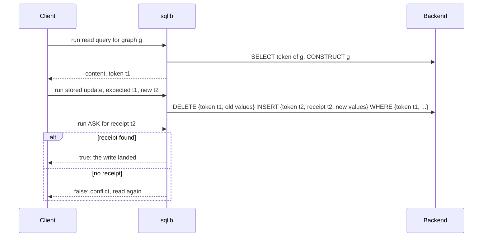

# Optimistic concurrency for backend data

Status: proposed, 2026-11-26. Nothing in this note is built.

## Decision

A stored update guards its own write. It reads an expected token and writes a
new token for each graph it changes, in one `DELETE`/`INSERT … WHERE`
operation. The tokens live in a metadata graph in the backend. This is a
pattern for query authors. sqlib does not enforce it and does not rewrite
update text.

- The guard and the write are one operation. On a store that runs one
  operation as one transaction, nothing can land between the check and the
  write.
- The caller passes the expected token and a new token as arguments. The new
  token is a fresh opaque value for each write, for example a UUID. A counter
  cannot tell a writer whether its own write landed (see "Read the outcome
  back").
- An update that changes several graphs guards all of them in the same
  operation. It is never split into one request for each graph.
- The unit of conflict is the named graph. Data with one record in each graph
  conflicts only when two people edit the same record.
- The pattern works on sqlib as it is now. "What sqlib can add" lists optional
  support: an `ETag` on reads, and `If-Match` mapped to the token argument.

The SPARQL 1.1 and 1.2 standards define no entity tags and no conditional
update. Some stores have their own mechanism, and no two of them are the same.
This pattern needs only SPARQL Update and one assumption about transactions,
which "Backend behaviour" lists for each backend.



## Background

sqlib already uses optimistic concurrency, but only for its own entities and
with gaps on backend data.

- Library entities carry `ETag` and `Last-Modified`, and every write route
  checks `If-Match` (`packages/api/src/routes/route-helpers.ts`). The revision
  is `dateModified`, made strictly increasing by `nextDateModified`
  (`packages/api/src/lib/CacheCoordinator.ts`).
- `POST /patches/:id/apply` re-derives a previewed patch and compares its
  `contentHash` (`resolveDelta` in `packages/api/src/lib/patchService.ts`).
  The re-derivation and the apply are separate requests to the backend. A
  write that lands between them is not detected.
- The `refusals` check of a published update runs the `WHERE` clause as
  `SELECT *`, then runs the update
  ([publishing-tools.md](../guides/publishing-tools.md#refusals-why-an-update-wrote-nothing)).
  The same window exists between those two requests.
- `GET /events` sends a `data-changed` frame with `backendId` and `patchId`
  when a patch is applied or reverted (`packages/api/src/lib/changeEvents.ts`).
  A plain update through `/sparql` or `/execute` sends no frame.
- No route answers `If-None-Match` with `304`
  (`packages/api/src/lib/httpCaching.ts`).

A guarded update closes both windows, because its check is part of the write.

## The metadata graph

A backend that holds versioned graphs has one metadata graph. This note uses
the name `urn:sqlib:graph-versions`.

```turtle
GRAPH <urn:sqlib:graph-versions> {
  <https://example.org/record/42> sqlib:version "01JD8Q3K…" .

  <urn:sqlib:rev:01JD8Q3K…> a sqlib:Revision ;
      sqlib:revisionOf <https://example.org/record/42> ;
      sqlib:previous "01JD8P0A…" ;
      prov:generatedAtTime "2026-11-26T07:00:00Z"^^xsd:dateTime .
}
```

- `sqlib:version` holds the current token of a graph. The caller mints the
  token, for example a UUID or a ULID.
- The update that creates a graph writes its first token. Its guard is
  `FILTER NOT EXISTS { GRAPH <urn:sqlib:graph-versions> { ?g sqlib:version ?any } }`,
  so two callers that create the same graph conflict.
- A `sqlib:Revision` is the receipt of one write. The receipts of a graph form
  a history through `sqlib:previous`.
- A stored cleanup update can delete receipts older than a retention time (for
  example 1 hour). A receipt must live longer than the read-back step.

A forged token would pass a guard. The graph policy of the backend can deny
writes to the metadata graph for every caller that does not run a guarded
update.

Some stores make the default graph the union of all named graphs. GraphDB does
this by default, and Fuseki does it with `tdb2:unionDefaultGraph`. On such a
store, a query with no `GRAPH` clause also matches the version triples. I
have not checked the GraphDB default in its current release. The graph policy can hide the metadata graph from reads too, but this changes the
results of existing queries that read the union. I have not checked GraphDB
with a policy that hides one graph.

## The guarded write

### The pattern

A stored update that follows the pattern has these parts:

1. One parameter for each guarded graph's expected token, and one for the new
   token: `VALUES (?expected ?new) { (UNDEF UNDEF) }`.
2. A guard pattern in the `WHERE` clause for each written graph:
   `GRAPH <urn:sqlib:graph-versions> { <g> sqlib:version ?expected }`.
3. In `DELETE`, the old token of each written graph.
4. In `INSERT`, the new token of each written graph, and one receipt.

```sparql
PREFIX ex: <http://example.org/>
PREFIX sqlib: <urn:sqlib:>
DELETE {
  GRAPH <urn:sqlib:graph-versions> { ?g sqlib:version ?expected }
  GRAPH ?g { ?item ex:status ?old }
}
INSERT {
  GRAPH <urn:sqlib:graph-versions> {
    ?g sqlib:version ?new .
    ?receipt a sqlib:Revision ; sqlib:revisionOf ?g ; sqlib:previous ?expected .
  }
  GRAPH ?g { ?item ex:status ?status }
}
WHERE {
  VALUES (?g ?item ?status ?expected ?new) { (UNDEF UNDEF UNDEF UNDEF UNDEF) }
  GRAPH <urn:sqlib:graph-versions> { ?g sqlib:version ?expected }
  OPTIONAL { GRAPH ?g { ?item ex:status ?old } }
  BIND(IRI(CONCAT("urn:sqlib:rev:", ?new)) AS ?receipt)
}
```

The guard pattern has one solution when the token holds, and none otherwise.
With no solution, the operation writes nothing: no data, no token and no
receipt.

The guard must not depend on the data part of the `WHERE` clause. In the
example, `OPTIONAL` keeps the solution when `?item` has no status yet. With a
plain pattern there, a guard that holds but a data pattern that matches nothing
writes no receipt. The read-back then reports a conflict that did not happen.
`DELETE WHERE` has this problem by its form, so a guarded write uses the long
form.

`INSERT DATA` and `DELETE DATA` have no `WHERE` clause and cannot hold a
guard. A guarded write uses `INSERT { … } WHERE { guard }` with the same
quads. `CLEAR`, `DROP`, `LOAD`, `CREATE`, `ADD`, `MOVE` and `COPY` cannot be
guarded.

### Several graphs

An update that changes graphs `g` and `h` holds both guards in its `WHERE`
clause, and both token changes in its templates. The two guard patterns join,
so the operation has a solution only when both tokens hold. It is one
operation, so the store applies all of it or none of it.

Two separate requests, one for each graph, can fail halfway. The first can land
and the second can find a moved token. The graph of the first then holds a
change that the second was meant to complete, and there is no rollback. A
guarded write that touches several graphs must therefore stay one operation.
Graphs scoped to one record each make such writes rare, but a move of an item
between two records still needs them.

A program of several operations (`op1 ; op2`) in one request is atomic on
in-process Oxigraph (tested, below) and on Fuseki. It is not needed for this
pattern, and other stores may not give it.

### Rules for the pattern

The guard is sound only when every write to a guarded graph moves its token. An
update that writes the graph and does not follow the pattern leaves the token
unchanged. A guarded write that holds the old token then passes and can
overwrite that change. sqlib does not check this. It is a rule for the authors
of the library that writes the graphs:

- Every stored update that writes a versioned graph follows the pattern.
- No caller writes a versioned graph through `/sparql` with an update that
  does not follow it.
- Nobody writes the metadata graph except through a guarded update. The graph
  policy of the backend can deny other writes to it.

### Graphs that the update reads

The update can also read graphs that it does not write. A `WHERE` clause can
copy values from graph `h` into graph `g`. A change to `h` does not fail a guard
on `g`. An author who depends on `h` adds a guard pattern for `h`, and leaves
its token unchanged.

### Options considered

- **sqlib injects the guard.** sqlib parses the update, adds a first operation
  that moves the tokens, and adds a guard pattern to each operation of the
  caller. Authors then write no guard code, and sqlib can make every writer
  move the token. It needs a parse of each update and a rewrite for each update
  form, and it cannot find the written graphs of a `GRAPH ?g` template.
- **sqlib derives the patch.** sqlib derives the ground patch with
  `derivePatch` and sends one operation with the patch quads and the guard. It
  finds the written graphs of any form that `derivePatch` supports. It costs
  two or more read queries for each write.

The pattern needs no change to sqlib, and both options can be added later
without a change to the metadata graph.

### Read the outcome back

SPARQL Update does not report whether the `WHERE` clause matched. The caller
asks after the update, with a stored `ASK` query:

```sparql
ASK { GRAPH <urn:sqlib:graph-versions> { <urn:sqlib:rev:t2> sqlib:revisionOf <g> } }
```

`true` means the guard held and the write landed. `false` means the guard
failed. The caller then reads the graph and its token again.

The check reads the receipt, and not the current token, for two reasons:

- A counter fails. Two writers that both expect `5` both write `6`. The loser
  reads `6` and believes it won.
- A unique token alone also fails. A third writer can move the token after the
  first write and before its read-back. The first writer then sees a different
  token and reports a conflict for a write that landed. A retry would apply the
  change twice. The receipt stays after later writes, so the check is stable.

## What sqlib can add

The pattern works without these. Each one removes work from the caller.

- **`If-Match` on an update.** `POST /execute` and `POST /tools/{slug}/{name}`
  could map the header to the expected-token parameter, mint the new token, run
  the `ASK`, and answer `412` with the current token.
- **`ETag` on a read.** A read whose dataset names exactly one versioned graph
  could return its token as an `ETag`.
- **A versions route.** `GET /backends/:id/graph-versions?graph=<g>` could
  return tokens and answer `If-None-Match` with `304`, for polling.
- **A change frame.** A `data-changed` frame on `GET /events` that names each
  graph and its new token (see "Background refresh").
- **A save check.** A warning when a saved update writes a versioned graph
  and has no guard pattern for it.

### Read order

Over HTTP, the token and the content are two queries unless one query returns
both. Read the token first. In the other order, a write between the two queries
gives old content with a new token, and the next guarded write passes and
overwrites the change. In this order, the same write gives new content with an
old token, and the next guarded write gets a false conflict. A single query that
returns the content and the token together avoids both cases, if the store
answers one query from one snapshot.

## The unit of conflict

### One version for each graph

The token belongs to a named graph. Two writes conflict when they write the same
graph, even when they change different triples. Data that keeps one record in
each graph gives conflicts only between two edits of the same record. Data that
keeps many records in one graph gives a conflict for each concurrent edit of any
two records.

This is the design for the first phase. It needs no change to the data model of
a library that already has one graph for each entity.

### One version for each subject

The token can belong to a subject IRI instead. The guard then has one pattern
for each subject that the update changes. With the pattern, the author names
those subjects. With the patch option, sqlib finds them in the patch: the
subject of each quad that it adds or deletes.

Considerations:

- The client must hold the tokens of the subjects it read. A record that spans
  several subjects, or blank nodes under one subject, needs a rule for which
  subject owns which triple. The Concise Bounded Description is one candidate.
- The metadata graph grows with the number of subjects.
- A write that creates a subject has no expected token for it. The
  `FILTER NOT EXISTS` guard covers this, and two writers that create the same
  subject conflict.

I recommend this as a later phase, after the per-graph version has use.

## Background refresh

A client that keeps its token fresh finds most conflicts before it saves. The
window for a conflict becomes the time between the last refresh and the save.

There are two ways to refresh:

- **Poll.** The client runs a stored `SELECT` of the tokens of the graphs it
  shows, with the graphs as a `VALUES` argument. This works now. With the
  versions route, the poll becomes `If-None-Match` and a `304`.
- **Push.** sqlib extends the `data-changed` frame of `GET /events` with
  `graphs: [{ graph, version }]`. This needs `If-Match` support in sqlib,
  because sqlib must know the tokens of a write to announce them. The frame
  names what changed and carries no content, as the feed does now.

The push path reaches only subscribers in the same process
(`changeEvents.ts` states this limit). Neither path detects an unguarded
write. A refresh does not replace the guard, because two saves
can land inside one refresh window.

### Unsaved local edits

When the token moves while a user has unsaved edits, the client has three
states: the base it loaded (`B`), the server state (`S`), and its own edits as a
patch `L` against `B`.

1. Fetch `S` with its new token.
2. Compute the server change `B → S` as quads.
3. Find the overlap. Two changes overlap when they touch the same subject and
   predicate.
4. With no overlap, keep `L` as it is and take the new token. `L` is ground, so
   it applies to `S` with no change.
5. With an overlap, show the conflict for those properties, and let the user
   choose.

sqlib could do steps 2 to 4 on the server, from the patch log, for a write with
an old token. This needs every write between the two tokens to be recorded as a
patch (`?record=patch`). It also changes a conflict into a merge that the
caller did not ask for. I recommend it only as an opt-in.

## Backend behaviour

The guard needs two properties from the store. One operation applies all of its
changes or none. Two concurrent operations do not both see the same old token.
The table gives what I know for each backend that
[storage-and-caching.md](../explanation/storage-and-caching.md#where-queries-run-backends)
names.

| Backend | One operation is atomic | Writers are serialised | Evidence |
| --- | --- | --- | --- |
| `oxigraphMemory`, `oxigraphEphemeral` (in process) | yes | yes, `Store.update` is synchronous in one JavaScript thread | Tested, Oxigraph 0.5.13 (below) |
| Fuseki with TDB2 | yes, one write transaction | yes, TDB2 has one writer at a time | Jena documentation. Not tested here. |
| Oxigraph server (RocksDB) | I think yes, from its documentation | not known | Not tested. Two concurrent transactions might both read the old token. |
| GraphDB | yes, one transaction | not known | Not tested. Depends on its isolation level. |
| Other SPARQL 1.1 endpoints | not known | not known | The standard does not say. |

Test with Oxigraph 0.5.13 in Node, in one store:

- `INSERT DATA { GRAPH <g> { … } } ; LOAD <file:///nope.ttl>` threw, and `<g>`
  held 0 triples after it. The first operation was rolled back.
- Two guarded updates that both expected token `"v1"` ran one after the other.
  The store held the token and the triple of the first writer only.
- The update in "The pattern", run twice with expected `"t1"` and new tokens
  `tA` and `tB`: receipt `tA` exists, receipt `tB` does not, and the status is
  the value of the first writer.
- The same update on an item with no status yet wrote its receipt, because the
  data pattern is `OPTIONAL`.
- A move of an item from graph 1 to graph 2, guarded on both tokens: with a
  stale token for graph 1 it wrote nothing in either graph and no receipt. With
  both tokens current it moved the item and wrote the receipt.

Before a library uses the pattern on a backend type, run a concurrency test on
it. The test starts N concurrent guarded writes with the same expected token,
and checks that exactly one receipt exists. The suite in
[testing-and-conformance.md](../guides/testing-and-conformance.md) is the place
for it. If sqlib adds `If-Match` support, it can refuse the header with `400`
on a backend type that has not passed.

## Limits

- **Unguarded writers.** A write that does not follow the pattern does not
  move the token. A guarded write can then overwrite it. This includes an
  unguarded stored update, an update through `/sparql`, and any application
  that writes to the store directly. The pattern itself runs the same through
  the API, browser backends
  (`packages/web/src/lib/browserBackendExecution.ts`) and the exported runtime,
  because the guard is in the query text.
- **Coarse unit.** See "The unit of conflict".
- **Cost.** A guarded write adds a guard pattern for each graph, and one `ASK`
  query after it.
- **Not enforced.** One stored update that skips the pattern breaks the guard
  for its graphs (see "Rules for the pattern").
- **Read-only backends.** An `oxigraphMemory` backend in `readOnly` mode has no
  writes. Its token can be the data graph version it was built from.

## Open questions

These need an answer from the maintainer:

1. Name of the metadata graph, and whether it is one graph per backend or one
   per library.
2. Retention time for receipts, or whether to keep them as a history.
3. Which items of "What sqlib can add" to build, and in which order.

## Phases

1. The pattern in a guide, with one example library. The concurrency test on
   in-process Oxigraph and Fuseki.
2. `If-Match` and `ETag` on the tool routes, and the save check.
3. The versions route with `304`, tokens in the `data-changed` frame, and the
   client merge of unsaved edits.
4. Per-subject tokens, and the opt-in server merge.
