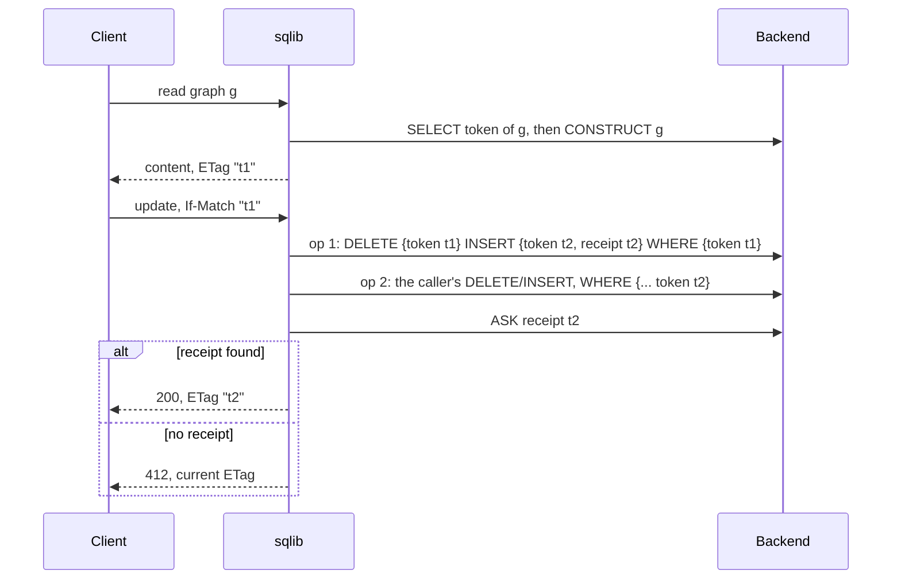

# Optimistic concurrency for backend data

Status: proposed, 2026-11-26. Nothing in this note is built.

## Decision

sqlib keeps a version token for each named graph of a backend, in a metadata
graph in that backend. A read returns the token of a graph as an `ETag`. An
update that sends `If-Match` runs only when the token is unchanged, and it
writes a new token in the same request. The caller gets `412` when the token
moved.

- The guard and the write are one SPARQL Update request. On a store that runs
  one request as one transaction, nothing can land between the check and the
  write.
- sqlib injects the guard into the caller's update. A first operation moves the
  token and writes a receipt. Each operation of the caller gets one guard
  pattern in its `WHERE` clause. Query authors write no guard code.
- When the text does not name the graphs it writes (`GRAPH ?g` in a template),
  sqlib uses the patch path (`packages/rdf-delta`) instead. "The patch path"
  describes it.
- The token is a fresh opaque value for each write. A counter cannot tell a
  writer whether its own write landed (see "Read the outcome back").
- The unit of conflict is the named graph. Data with one record in each graph
  conflicts only when two people edit the same record.

The SPARQL 1.1 and 1.2 standards define no entity tags and no conditional
update. Some stores have their own mechanism, and no two of them are the same.
This design needs only SPARQL Update and one assumption about transactions,
which "Backend behaviour" lists for each backend.



## Background

sqlib already uses optimistic concurrency, but only for its own entities and
with gaps on backend data.

- Library entities carry `ETag` and `Last-Modified`, and every write route
  checks `If-Match` (`packages/api/src/routes/route-helpers.ts`). The revision
  is `dateModified`, made strictly increasing by `nextDateModified`
  (`packages/api/src/lib/CacheCoordinator.ts`).
- `POST /patches/:id/apply` re-derives a previewed patch and compares its
  `contentHash` (`resolveDelta` in `packages/api/src/lib/patchService.ts`).
  The re-derivation and the apply are separate requests to the backend. A
  write that lands between them is not detected.
- The `refusals` check of a published update runs the `WHERE` clause as
  `SELECT *`, then runs the update
  ([publishing-tools.md](../guides/publishing-tools.md#refusals-why-an-update-wrote-nothing)).
  The same window exists between those two requests.
- `GET /events` sends a `data-changed` frame with `backendId` and `patchId`
  when a patch is applied or reverted (`packages/api/src/lib/changeEvents.ts`).
  A plain update through `/sparql` or `/execute` sends no frame.
- No route answers `If-None-Match` with `304`
  (`packages/api/src/lib/httpCaching.ts`).

The guard in this note closes the two windows above for a caller that sends
`If-Match`.

## The metadata graph

Each backend that enables versions has one metadata graph. The default name is
`urn:sqlib:graph-versions`. A backend setting can change it.

```turtle
GRAPH <urn:sqlib:graph-versions> {
  <https://example.org/record/42> sqlib:version "01JD8Q3K…" .

  <urn:sqlib:rev:01JD8Q3K…> a sqlib:Revision ;
      sqlib:revisionOf <https://example.org/record/42> ;
      sqlib:previous "01JD8P0A…" ;
      sqlib:patch <urn:sqlib:patch:…> ;
      prov:generatedAtTime "2026-11-26T07:00:00Z"^^xsd:dateTime .
}
```

- `sqlib:version` holds the current token of a graph. sqlib mints the token, for
  example a ULID.
- A graph with no `sqlib:version` triple has the token `"unversioned"`. Its
  guard is `FILTER NOT EXISTS { GRAPH <meta> { <g> sqlib:version ?any } }`.
  The first guarded write gives it a real token.
- A `sqlib:Revision` is the receipt of one write. It links to the `Patch`
  entity, so the patch log and the version history join on the patch id.
- sqlib deletes receipts older than a retention time (for example 1 hour). A
  receipt must live longer than the read-back step.

A user must not write the metadata graph. A forged token would pass a guard. The
graph policy of the backend must deny writes to the metadata graph for every
caller except sqlib. Reads of the metadata graph can be allowed.

Some stores make the default graph the union of all named graphs. GraphDB does
this by default, and Fuseki does it with `tdb2:unionDefaultGraph`. On such a
store, a query with no `GRAPH` clause also matches the version triples. I have not checked the GraphDB default in its current release. The
graph policy can hide the metadata graph from reads too, but this changes the
results of existing queries that read the union. I have not checked GraphDB
with a policy that hides one graph.

## The guarded write

### Steps

1. Take the expected tokens from the request: `If-Match` for one graph, or a
   body field `expectedVersions` (a map from graph IRI to token) for more.
2. Find the graphs that the update writes, from the parsed text: each
   `GRAPH <g>` in a template, `WITH <g>`, and the graph of each quad in
   `INSERT DATA` and `DELETE DATA`. A template that writes the default graph
   with no `WITH` writes the default graph, which has no token.
3. Use the patch path when a template has `GRAPH ?g` with a variable. The text
   then does not say which graphs it writes.
4. Refuse with `428` when the update writes a graph that has no expected token.
   A guard that covers only some written graphs gives a false promise.
5. Mint one new token for the request.
6. Send the rewritten update to the backend (below), as one request.
7. Read the outcome back (below).
8. Publish a `data-changed` frame that names each graph and its new token.

### The update text

For expected token `t1` on graph `g` and new token `t2`, sqlib puts one
operation in front of the caller's operations:

```sparql
DELETE { GRAPH <urn:sqlib:graph-versions> { <g> sqlib:version "t1" } }
INSERT {
  GRAPH <urn:sqlib:graph-versions> {
    <g> sqlib:version "t2" .
    <urn:sqlib:rev:t2> a sqlib:Revision ; sqlib:revisionOf <g> ; sqlib:previous "t1" .
  }
}
WHERE { GRAPH <urn:sqlib:graph-versions> { <g> sqlib:version "t1" } } ;
```

Then sqlib adds the pattern `GRAPH <urn:sqlib:graph-versions> { <g>
sqlib:version "t2" }` to the `WHERE` clause of each operation of the caller.
For several graphs, each part holds one pattern for each graph.

```sparql
DELETE { GRAPH <g> { ?s ex:status "draft" } }
INSERT { GRAPH <g> { ?s ex:status "live" } }
WHERE {
  GRAPH <g> { ?s ex:status "draft" }
  GRAPH <urn:sqlib:graph-versions> { <g> sqlib:version "t2" }
}
```

The guard pattern shares no variable with the caller's pattern, so it joins
as one row or as none. `t2` is unique to this request. A caller's operation
therefore finds a solution only when the first operation ran.

The bump is a separate operation for this reason. A bump in the caller's
templates is instantiated once for each solution of the caller's `WHERE`. A
`WHERE` with no solution would then leave the token and the receipt
unwritten, and the read-back would report `412` for a token that was current.
With the separate operation, an update that matches nothing still moves the
token. Other holders of `t1` then get a `412` for a write that changed no
triple. I accept this cost, because the alternative gives a wrong answer.

Each update form needs this treatment:

| Form | Rewrite |
| --- | --- |
| `DELETE`/`INSERT … WHERE`, `DELETE WHERE` | add the guard pattern to `WHERE`. `DELETE WHERE { P }` becomes `DELETE { P } WHERE { P guard }`. |
| `INSERT DATA { Q }`, `DELETE DATA { Q }` | becomes `INSERT { Q } WHERE { guard }` or `DELETE { Q } WHERE { guard }` |
| `USING NAMED`, or `using-named-graph-uri` in the request | add `urn:sqlib:graph-versions` to the named graphs, or the guard pattern matches nothing |
| `USING` with no `USING NAMED` | add `USING NAMED <urn:sqlib:graph-versions>`. A `USING` clause empties the named graphs of the dataset. |
| `CLEAR`, `DROP`, `LOAD`, `CREATE`, `ADD`, `MOVE`, `COPY` | refuse with `422`. These forms have no `WHERE` clause. |

The rewrite needs one property from the store: all operations of one request
apply together or not at all. "Backend behaviour" gives the evidence for each
backend.

### Options considered

- **Authors write the guard.** A stored update could carry the check itself,
  as a `refusals` flag such as `?ok_current` on an expected-token parameter
  ([publishing-tools.md](../guides/publishing-tools.md#refusals-why-an-update-wrote-nothing)).
  sqlib still has to mint the token, write the receipt and read back. The guard
  is sound only when every write to the graph moves the token. One stored update
  without the check breaks the guard for every caller. sqlib would have to
  refuse such updates, which is the same parse that the injection needs.
- **Always use the patch path.** It costs two or more read queries for each
  write (see below). It handles `GRAPH ?g` templates, which the injection
  cannot.

### The patch path

sqlib derives the ground patch `P` of the update with `derivePatch`, as
`previewUpdate` does. The patch lists the graphs that it writes
(`graphScope`). sqlib then sends one operation that holds the patch quads and
the guard:

```sparql
DELETE {
  GRAPH <urn:sqlib:graph-versions> { <g> sqlib:version "t1" }
  # each quad of P-
}
INSERT {
  GRAPH <urn:sqlib:graph-versions> {
    <g> sqlib:version "t2" .
    <urn:sqlib:rev:t2> a sqlib:Revision ; sqlib:revisionOf <g> ; sqlib:previous "t1" .
  }
  # each quad of P+
}
WHERE {
  GRAPH <urn:sqlib:graph-versions> { <g> sqlib:version "t1" }
}
```

- The `WHERE` clause has one solution when every token holds, and none
  otherwise. It is one operation, so it needs no multi-operation atomicity.
- A patch with blank nodes in its deletions cannot be sent as SPARQL.
  `applyDelta` already refuses it with `422` for an HTTP backend.
- A patch with an unenumerated graph operation (`CLEAR`, `DROP`, `LOAD`) gives
  `422`, as `applyDelta` does now. With `enumerateGraphOps` it becomes quads and
  can be guarded.
- `POST /patches/:id/apply` uses this path. The guard replaces the hash
  re-check there for the written graphs.

The derivation reads the store before the guarded write. A write to `g`
between the two moves the token, and the guard fails.

### Graphs that the update reads

The update can also read graphs that it does not write. A `WHERE` clause can
copy values from graph `h` into graph `g`. A change to `h` does not fail a guard
on `g`. A caller that depends on `h` adds `h` to `expectedVersions`. sqlib then
checks the token of `h` and does not move it. sqlib could add every graph in the
update dataset by default. I recommend the explicit form, because a default
guard on a large reference graph would refuse most writes.

### Read the outcome back

SPARQL Update does not report whether the `WHERE` clause matched. sqlib asks
after the update:

```sparql
ASK { GRAPH <urn:sqlib:graph-versions> { <urn:sqlib:rev:t2> sqlib:revisionOf <g> } }
```

`true` means the guard held and the write landed. `false` means the guard
failed. sqlib then reads the current token and returns `412` with it.

The check reads the receipt, and not the current token, for two reasons:

- A counter fails. Two writers that both send `If-Match: "5"` both write `6`.
  The loser reads `6` and believes it won.
- A unique token alone also fails. A third writer can move the token after the
  first write and before its read-back. The first writer then sees a different
  token and reports `412` for a write that landed. A retry would apply the
  change twice. The receipt stays after later writes, so the check is stable.

An in-process Oxigraph store needs no read-back. `Store.update` is synchronous
in the JavaScript binding (`packages/runtime-oxigraph/src/index.ts`), so sqlib
can read the token, compare it and run the update with no other JavaScript in
between.

### Where callers send `If-Match`

| Route | How the caller sends the expected tokens |
| --- | --- |
| `POST /sparql` with a `backendId` | `If-Match` header, or `expectedVersions` in the body |
| `POST /execute` on an update | the same |
| `POST /tools/{slug}/{name}` | the same |
| `POST /patches/:id/apply` | the same, on the patch path |
| MCP tools that run an update | an `expectedVersions` argument |

A request without expected tokens behaves as it does now. It still bumps the
token of every graph it writes, so that guarded callers see the change. A
backend without versions enabled ignores `If-Match` and answers as now, or
refuses it with `400`. I recommend `400`, so that a caller does not believe it
has a guard that it does not have.

### Where reads return the token

- A new route `GET /backends/:id/graph-versions?graph=<g>&graph=<h>` returns the
  tokens, with an `ETag` for a single graph. It answers `If-None-Match` with
  `304`.
- A read through `/sparql` or `/execute` whose dataset names exactly one graph
  can return that graph's `ETag`. A read over several graphs returns the tokens
  in a `Sqlib-Graph-Versions` header.

Over HTTP, sqlib reads the token before it reads the content. In the other
order, a write between the two requests gives the caller old content with a new
token, and its next guarded write would pass and overwrite the change. In this
order, the same write gives new content with an old token, and the next guarded
write gets a false `412`. A single query that returns the content and the token
together avoids both cases, if the store answers one query from one snapshot.

## The unit of conflict

### One version for each graph

The token belongs to a named graph. Two writes conflict when they write the same
graph, even when they change different triples. Data that keeps one record in
each graph gives conflicts only between two edits of the same record. Data that
keeps many records in one graph gives a conflict for each concurrent edit of any
two records.

This is the design for the first phase. It needs no change to the data model of
a library that already has one graph for each entity.

### One version for each subject

The token can belong to a subject IRI instead. The patch gives the subjects that
a write changes: the subject of each quad in `P+` and `P-`. sqlib does not need
to parse the update text to find them. The guard then has one pattern for each
changed subject.

Considerations:

- The client must hold the tokens of the subjects it read. A record that spans
  several subjects, or blank nodes under one subject, needs a rule for which
  subject owns which triple. The Concise Bounded Description is one candidate.
- The metadata graph grows with the number of subjects.
- A write that adds a triple to a new subject has no expected token for it. The
  `"unversioned"` rule covers this, but two writers that both create the same
  subject then conflict, which is correct.

I recommend this as a later phase, after the per-graph version has use.

## Background refresh

A client that keeps its token fresh finds most conflicts before it saves. The
window for a conflict becomes the time between the last refresh and the save.

There are two ways to refresh:

- **Push.** Extend the `data-changed` frame of `GET /events` with
  `graphs: [{ graph, version }]`, and publish it for every write through sqlib.
  The frame names what changed and carries no content, as the feed does now.
- **Poll.** The client sends `GET /backends/:id/graph-versions` with
  `If-None-Match`. A `304` costs one small SPARQL query on the backend.

The push path reaches only subscribers in the same process
(`changeEvents.ts` states this limit). Neither path detects a write that does
not go through sqlib. A refresh does not replace the guard, because two saves
can land inside one refresh window.

### Unsaved local edits

When the token moves while a user has unsaved edits, the client has three
states: the base it loaded (`B`), the server state (`S`), and its own edits as a
patch `L` against `B`.

1. Fetch `S` with its new token.
2. Compute the server change `B → S` as quads.
3. Find the overlap. Two changes overlap when they touch the same subject and
   predicate.
4. With no overlap, keep `L` as it is and take the new token. `L` is ground, so
   it applies to `S` with no change.
5. With an overlap, show the conflict for those properties, and let the user
   choose.

sqlib could do steps 2 to 4 on the server. For a request whose `If-Match` is
old, it would read the patches between the old token and the current token from
the patch log (`sqlib:previous` links them). It would then apply the request
when nothing overlaps. This only works when every write between the two tokens
went through sqlib, and it changes `412` into a merge that the caller did not
ask for. I recommend it only as an opt-in.

## Backend behaviour

The guard needs one property from the store: one update request applies all of
its changes or none, and two update requests do not both see the same old token.
The table gives what I know for each backend that
[storage-and-caching.md](../explanation/storage-and-caching.md#where-queries-run-backends)
names.

| Backend | One request is atomic | Writers are serialised | Evidence |
| --- | --- | --- | --- |
| `oxigraphMemory`, `oxigraphEphemeral` (in process) | yes | yes, `Store.update` is synchronous in one JavaScript thread | Tested, Oxigraph 0.5.13 (below) |
| Fuseki with TDB2 | yes, one write transaction | yes, TDB2 has one writer at a time | Jena documentation. Not tested here. |
| Oxigraph server (RocksDB) | I think yes, from its documentation | not known | Not tested. Two concurrent transactions might both read the old token. |
| GraphDB | yes, one transaction | not known | Not tested. Depends on its isolation level. |
| Other SPARQL 1.1 endpoints | not known | not known | The standard does not say. |

Test with Oxigraph 0.5.13 in Node, in one store:

- `INSERT DATA { GRAPH <g> { … } } ; LOAD <file:///nope.ttl>` threw, and `<g>`
  held 0 triples after it. The first operation was rolled back.
- Two guarded updates that both expected token `"v1"` ran one after the other.
  The store held the token and the triple of the first writer only.
- The injected shape, two requests that both expected `"t1"`, one after the
  other: the first left receipt `tA` and changed the triple. The second left no
  receipt and changed nothing.
- The injected shape, with a caller operation that matched nothing: the
  receipt was written, so the read-back reports success.

Before sqlib enables the guard for a backend type, a conformance test must run
it. The test starts N concurrent guarded writes with the same expected token,
and checks that exactly one receipt exists. The suite in
[testing-and-conformance.md](../guides/testing-and-conformance.md) is the place
for it. Until a backend type passes, sqlib refuses `If-Match` on it with `400`.

## Limits

- **Writes that bypass sqlib.** A write that goes straight to the endpoint does
  not move the token. A guarded write can then overwrite it. This includes
  browser backends (`packages/web/src/lib/browserBackendExecution.ts` posts to
  the endpoint), the exported runtime, and any other application with write
  access to the store. The guard is sound only when sqlib is the only writer
  of the guarded graphs. The current patch hash check detects such a write for
  the quads that a patch deletes, and sqlib can keep that check as a second
  guard.
- **Coarse unit.** See "The unit of conflict".
- **Cost.** An injected guard adds one operation to the request and one `ASK`.
  The patch path adds the derivation queries too. The derivation already runs
  for `?record=patch` and for a patch preview.
- **Read-only backends.** An `oxigraphMemory` backend in `readOnly` mode has no
  writes. Its token can be the data graph version it was built from.

## Open questions

These need an answer from the maintainer:

1. Name of the metadata graph, and whether it is one graph per backend or one
   per library.
2. Behaviour of `If-Match` on a backend without versions: `400` (recommended)
   or ignore.
3. Whether a guard covers the read graphs of the update dataset by default, or
   only when the caller names them (recommended).
4. Retention time for receipts.

## Phases

1. Per-graph tokens, the injected guard, the patch path, and the read-back on in-process Oxigraph
   and Fuseki. The conformance test. The `graph-versions` route with `304`.
2. Tokens in the `data-changed` frame, and the client merge of unsaved edits in
   the web app.
3. Per-subject tokens, and the opt-in server merge.
