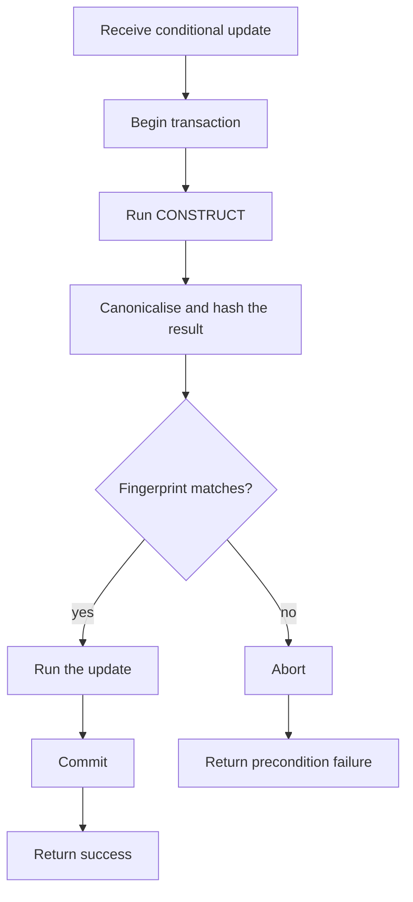

# Query-defined preconditions for SPARQL updates

Status: proposed, 2026-11-26. Nothing in this note is
built. [graph-version-concurrency.md](graph-version-concurrency.md) gives a
pattern that works on current stores, with tokens in a metadata graph.

## Decision

A conditional update carries a CONSTRUCT query and the fingerprint of its
expected result. The server runs the CONSTRUCT, canonicalises and hashes the
result, and runs the update only when the hash matches. The query and the
update run in one transaction.

- The CONSTRUCT defines the precondition. The application chooses the
  boundary, and the layout of the dataset does not constrain it.
- No version metadata is stored. Any write that changes the CONSTRUCT result
  fails the precondition, whether or not that writer used the mechanism.
- The fingerprint is a hash of the RDFC-1.1 canonical form of the result.
- The server reports a failed precondition explicitly.
- The mechanism is an extension of the SPARQL Protocol. The query and update
  languages do not change.

## Motivation

SPARQL has no standard way to run an update on the condition that the result of
an earlier query is unchanged.

Web applications usually implement optimistic concurrency with record versions
and HTTP conditional requests. RDF has no record boundary that matches a
database row. Named graphs can give one, but then concurrency control depends on
how the dataset is organised. With a query-defined precondition, the
application defines the boundary in the query.

## Mechanism

### Read

The client runs a CONSTRUCT that selects the state it depends on:

```sparql
CONSTRUCT { ex:person ?p ?o }
WHERE { ex:person ?p ?o }
```

The server returns the graph and its fingerprint. The fingerprint does not
change when only the triple order or the blank node labels change.

### Conditional update

The client sends three things:

- the CONSTRUCT query of the read,
- the expected fingerprint,
- a SPARQL Update request.

```sparql
DELETE { ex:person ex:phone ?oldPhone }
INSERT { ex:person ex:phone "0400123456" }
WHERE { OPTIONAL { ex:person ex:phone ?oldPhone } }
```

The client does not calculate an RDF patch. The update holds no concurrency
logic.

### Atomic execution

The server runs these steps in one transaction:



The isolation of the transaction must prevent a concurrent write from changing
the CONSTRUCT result between the check and the update.

## Semantics

The CONSTRUCT and the update are independent operations. The update can change
data outside the CONSTRUCT result. An application can make an update to one
resource depend on the state of another resource, or of several related
resources. The application is responsible for a correct boundary.

The comparison uses RDF graph isomorphism, through the hash of the canonical
form ([RDF Dataset Canonicalization](https://www.w3.org/TR/rdf-canon/)). These
changes do not fail a precondition:

- a change in triple order,
- a change in serialisation format,
- a change in blank node labels.

The comparison is on graph structure. It does not apply an entailment regime.

## Outcomes

| Outcome | Meaning |
| --- | --- |
| Applied | The precondition matched, and the update changed the dataset. |
| Unchanged | The precondition matched, and the update changed nothing. |
| Precondition failed | The CONSTRUCT result changed, and the update did not run. |

An execution error is a separate outcome. A guard inside an update `WHERE`
clause cannot give these outcomes, because a failed guard and an update that
matched nothing both write nothing and both succeed.

## HTTP

When the CONSTRUCT has its own HTTP resource, its fingerprint can be the
`ETag` of that resource. A conditional update then sends `If-Match`, and a
failed precondition answers `412` ([RFC 9110](https://www.rfc-editor.org/rfc/rfc9110.html)).
For an arbitrary query sent to a generic endpoint, a fingerprint parameter can
be a better fit. This note leaves the wire format open.

## Comparison

| Approach | Concurrency boundary | Requires |
| --- | --- | --- |
| Named graph versions | named graph | persistent version metadata |
| Client RDF patches | application-defined | change tracking in the client |
| Guards in the update `WHERE` | query pattern | concurrency logic in each update, and a read-back to detect failure |
| This proposal | CONSTRUCT result | atomic query and update, canonicalisation, fingerprint comparison |

A client can still send a precomputed RDF patch as its update.

## In sqlib

sqlib can implement the mechanism exactly only where it controls the
transaction.

- **In-process Oxigraph.** `Store.query` and `Store.update` are synchronous in
  the JavaScript binding (`packages/runtime-oxigraph/src/index.ts`). sqlib can
  run the CONSTRUCT, hash it and run the update with no other write between
  them.
- **HTTP backends.** The SPARQL Protocol gives one transaction for each request.
  sqlib cannot hold a transaction open across a query and an update, so a write
  can land between them. `POST /patches/:id/apply` has this gap now: it
  re-derives the patch, compares `contentHash`, then applies in a separate
  request (`packages/api/src/lib/patchService.ts`). An exact implementation
  needs the store, for example a Fuseki extension that runs both steps in one
  TDB2 write transaction.
- **Emulation in the update.** SPARQL cannot compute the fingerprint inside a
  `WHERE` clause. For a CONSTRUCT whose template equals its pattern, and whose
  expected result `G` has no blank nodes, sqlib can write the check as a guard.
  The guard requires each triple of `G` to exist, and has a `FILTER NOT EXISTS`
  for any matching triple outside `G`. The guard has the read-back problem of
  [graph-version-concurrency.md](graph-version-concurrency.md#read-the-outcome-back).
- **Unchanged outcome.** No store reports whether an update changed anything.
  `packages/rdf-delta` derives the net patch of an update, and an empty net
  patch is the Unchanged outcome.
- **Fingerprint as `ETag`.** A published CONSTRUCT tool with its arguments is an
  HTTP resource: `GET /tools/{slug}/{name}?…`. Its response can carry the
  fingerprint as `ETag`. `packages/api/src/lib/rdfCanonicalizer.ts` already
  gives the canonical form for the patch `contentHash`.

## Limits and open questions

- The cost of evaluating and canonicalising a large result again on each write.
- Canonicalisation of graphs with many blank nodes can be expensive. A server
  needs a limit on that work.
- Non-deterministic queries: `LIMIT` or `OFFSET` without `ORDER BY`, `SAMPLE`,
  `NOW()`, `RAND()` and `UUID()`.
- The isolation level that each store must give.
- The HTTP representation of the request and the response.
- Whether ASK results and SELECT results can also be preconditions.
- Whether the Applied and Unchanged outcomes are mandatory.
- The mechanism compares current state. A change that was made and then
  reversed between the read and the update is not detected.

## Prior work

- [SPARQL Working Group ISSUE-18: Concurrency in SPARQL/Update](https://www.w3.org/2009/sparql/track/issues/18).
- I think Linked Data Platform and Solid servers use `ETag` and `If-Match` on
  RDF resources, with the HTTP resource as the boundary. I have not checked
  their specifications for this note.
- Check other prior proposals before a claim that the query-defined boundary is
  new.

## Standards

- [SPARQL 1.1 Query Language](https://www.w3.org/TR/sparql11-query/)
- [SPARQL 1.1 Update](https://www.w3.org/TR/sparql11-update/)
- [SPARQL 1.1 Protocol](https://www.w3.org/TR/sparql11-protocol/)
- [RDF Dataset Canonicalization](https://www.w3.org/TR/rdf-canon/)
- [RFC 9110: HTTP Semantics](https://www.rfc-editor.org/rfc/rfc9110.html)

## Next steps

1. A reference implementation in Fuseki with TDB2.
2. The same mechanism in sqlib on in-process Oxigraph.
3. A review of prior proposals.
