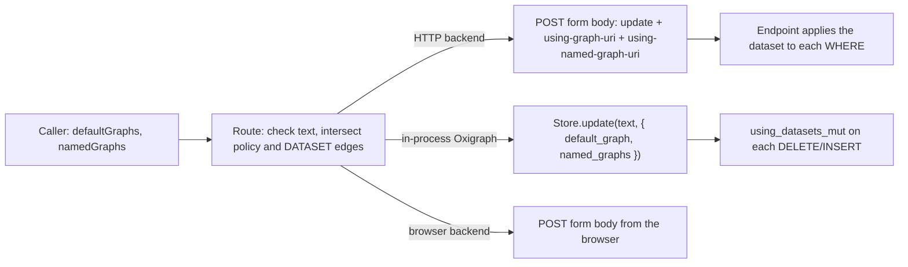

# Graph selection for updates

Status: implemented in
[#165](https://github.com/recalcitrantsupplant/sqlib/pull/165). An earlier
version of #165 added `USING` clauses to the update text. This proposal
replaced that design, and #165 now follows it.

## Decision

A caller can choose the graphs that an update's `WHERE` clause reads, at run
time. This is the update counterpart of the read-side dataset (`defaultGraphs`
and `namedGraphs`, which stand in for `FROM` and `FROM NAMED`).

sqlib applies the choice through the native mechanism of each backend. It does
not change the update text.

- An HTTP backend gets the SPARQL 1.1 Protocol parameters `using-graph-uri` and
  `using-named-graph-uri` (Protocol §2.2.3).
- An in-process Oxigraph store gets the dataset as an option of
  `Store.update`. The Rust core of Oxigraph has this API
  (`PreparedSparqlUpdate::using_datasets_mut`). The JavaScript binding does
  not expose it yet, so sqlib needs a small upstream change. Until a release
  has it, sqlib refuses a dataset on an in-process update.

The request fields stay `defaultGraphs` and `namedGraphs`. For an update they
set the dataset that each `DELETE/INSERT` operation's `WHERE` clause reads. They
do not change the graphs that the update writes to.



## Background

### The read side today

A read takes a run-time dataset on `/sparql`, `/execute`, query group runs and
`DATASET` edges. `packages/api/src/lib/dataset.ts` holds the model:

- An HTTP backend gets `default-graph-uri` and `named-graph-uri` pairs in a
  form body (`HttpSparqlExecutor.ts:96-112`). The body is used even for a GET
  backend, because Fuseki answered 414 at 10,000 graphs in a URL.
- An in-process Oxigraph store gets the `default_graph` and `named_graphs`
  options of `Store.query` (`OxigraphSparqlExecutor.ts:29-39`,
  `runtime-oxigraph/src/index.ts:134-138`).
- An empty part is sent over HTTP as `urn:sqlib:empty-dataset`, a graph that
  holds nothing. Oxigraph gets the empty list.
- A graph policy intersects its dataset with the caller's dataset
  (`GuardedSparqlExecutor.ts:107`).

On `main` (`deb2aaa`), every route refuses a dataset on an update with 400
(`routes/sparql.ts:349`, `routes/execute.ts:1235`), and a `DATASET` edge cannot
target an update node (`GraphBuilder.ts:300`).

### PR #165

PR #165 (open, branch `claude/project-thread-d7khw2`) adds update datasets. It
sends the protocol parameters to HTTP backends. For Oxigraph it parses the
update and generates new text with `USING` clauses (`lib/updateDataset.ts`,
`withUsingClauses`), and it rewrites `DELETE WHERE` as `DELETE … WHERE`. The
recorded patch and the patch preview also derive from the rewritten text. This
design keeps the HTTP part, the route checks and the policy work of #165. It
removes the rewrite. See [Changes to PR #165](#changes-to-pr-165).

## What the protocol defines

SPARQL 1.1 Protocol §2.2.3 gives an update request two optional parameters,
each repeatable:

| Parameter | Same as | Sets |
| --- | --- | --- |
| `using-graph-uri` | `USING <g>` | the default graph of the `WHERE` clause: the merge of the listed graphs |
| `using-named-graph-uri` | `USING NAMED <g>` | the named graphs that `GRAPH ?g` and `GRAPH <g>` in the `WHERE` clause can match |

Compared with the read parameters:

| | Read (`default-graph-uri`, `named-graph-uri`) | Update (`using-graph-uri`, `using-named-graph-uri`) |
| --- | --- | --- |
| Applies to | the whole query | the `WHERE` clause of each `DELETE/INSERT` operation |
| Text has its own (`FROM`, or `USING`/`WITH`) | the parameters win | error: the service must answer 400 |
| Write target | none | unchanged: a template writes to the store's default graph, or to the graph its `GRAPH` block names |
| Transport | GET or POST | POST only: in the form body, or in the URL of a direct `application/sparql-update` POST |

A part that is given makes the other part empty, as SPARQL 1.1 Query §13.2
says for `FROM` and `FROM NAMED`. Fuseki builds the update dataset with
`DynamicDatasets.dynamicDataset`, which does this. The Oxigraph server sets
both parts when either parameter is present (`oxigraph-cli` 0.5.13,
`main.rs:1610-1616`).

## Design

### API surface

No new request fields. The existing fields take on update meaning:

| Route | Fields | Change |
| --- | --- | --- |
| `POST /sparql` | `defaultGraphs`, `namedGraphs` in the JSON body | accepted for an update |
| `GET /sparql` | `default-graph-uri`, `named-graph-uri` | none: `GET /sparql` refuses updates (`allowUpdate: false`) |
| `POST /execute` (query or query version) | `defaultGraphs`, `namedGraphs` | accepted for an update |
| `POST /execute` (query group) | `defaultGraphs`, `namedGraphs` | applied to update nodes too |
| MCP `execute_run`, `sparql_proxyQuery` | same as the routes | none: the tools take the route schemas |

The contract descriptions in `packages/contracts/src/schema/contract-routes.ts`
(`datasetGraphsJsonSchema` and the `/sparql` body) change to say that, for an
update, the fields set what the `WHERE` clause reads.

The meaning of absent and empty is the same as for reads:

- Both fields absent: no dataset. The update runs as written, and nothing
  extra is sent.
- One field given: the other part is empty.
- An empty array: that part has no graphs. A `WHERE` that reads it matches
  nothing, so the operation writes nothing.

### Executor interface

`ISparqlExecutor.update` takes options, as in #165:

```ts
export type SparqlUpdateOptions = {
  /** The dataset that each DELETE/INSERT operation's WHERE clause reads. */
  dataset?: SparqlDataset;
};

update(sparqlUpdateQuery: string, options?: SparqlUpdateOptions): Promise<SparqlExecutionResult<void>>;
```

Each executor also states whether it can apply an update dataset:

```ts
/** False when this executor cannot apply `SparqlUpdateOptions.dataset`. */
readonly supportsUpdateDataset: boolean;
```

The route checks the flag before it runs anything. An executor that is given a
dataset it cannot apply throws. It never runs the update without the dataset.

In `packages/runtime`, `UpdateRequest` gets the same field:

```ts
export interface UpdateRequest {
  updateText: string;
  signal?: AbortSignal;
  /** The dataset the WHERE clauses read. Executors that cannot apply one must refuse it. */
  dataset?: SparqlDataset;
}
```

This is the rule `ExecutionRequest.dataset` already has
(`runtime/src/executor.ts:55`).

### HTTP backends

`HttpSparqlExecutor` sends one form-encoded POST:

```
POST <updateEndpoint>
Content-Type: application/x-www-form-urlencoded

update=<text>&using-graph-uri=<g1>&using-graph-uri=<g2>&using-named-graph-uri=<g3>
```

- One pair for each graph, in the order given.
- An empty part is sent as `urn:sqlib:empty-dataset`, as for reads. Without
  it, an endpoint would read its whole dataset for that part.
- The form body carries any number of graphs. The URL form would hit the same
  414 limit as reads.
- `supportsUpdateDataset` is true.

This is the #165 code (`updateDatasetProtocolParameters`), unchanged.

Endpoint behaviour, from the source code. I have not run these endpoints.

| Endpoint | Supports the parameters | Text has `USING` or `WITH` | `DELETE WHERE` |
| --- | --- | --- | --- |
| Fuseki 5.5.0 | yes (`SPARQL_Update.processProtocol`, `UsingUpdateSink`) | 400 for a non-transactional dataset. 500 for a transactional one (TDB2, in-memory), because the error comes from `UpdateAction.parseExecute` and goes to `ServletOps.errorOccurred`. | ignores the parameters: `UpdateDeleteWhere` is not an `UpdateWithUsing` |
| Oxigraph server 0.5.13 | yes (`configure_and_evaluate_sparql_update`) | 400 | applies the parameters (see [Evidence](#evidence)) |
| GraphDB, Virtuoso, QLever, Stardog | not checked | not checked | not checked |

The two rows differ on two points. sqlib makes them the same with its own
checks before it sends anything:

- sqlib refuses `USING` or `WITH` with a dataset itself, with 400. The caller
  never sees Fuseki's 500.
- sqlib refuses `DELETE WHERE` with a dataset, with 400. Fuseki would run it
  over the whole store and Oxigraph over the chosen graphs. See
  [Interaction with the update text](#interaction-with-the-update-text).

An endpoint that ignores unknown parameters would run the `WHERE` clause over
its whole dataset. sqlib cannot detect this from the response. See
[Open questions](#open-questions).

### In-process Oxigraph

#### What Oxigraph has

The Rust core applies a dataset per operation. `SparqlEvaluator::parse_update`
returns a `PreparedSparqlUpdate`, and `using_datasets_mut()` yields one
`QueryDatasetSpecification` for each `DELETE/INSERT` operation
(`oxigraph` 0.5.13, `src/sparql/update.rs:82`). The parser gives each one the
`USING` clauses of the text, or the `WITH` graph, or the default dataset.
`is_default_dataset()` is true only when the text names neither. The Oxigraph
server uses exactly this to implement `using-graph-uri`.

The JavaScript binding does not expose it. `Store.update(update, options)`
reads only `base_iri` (`js/src/store.rs` at v0.5.13 and on `main`), and the
type definition lists only `base_iri`. In 0.5.13 a `default_graph` option on
`update` is ignored with no error. The thread that opened #165 found this by a
probe.

#### Upstream change

Add the dataset options of `Store.query` to `Store.update`, with the same names
and the same parsing:

```ts
update(update: string, options?: {
  base_iri?: NamedNode | string;
  default_graph?: BlankNode | DefaultGraph | NamedNode | Iterable<BlankNode | DefaultGraph | NamedNode>;
  named_graphs?: Iterable<BlankNode | NamedNode>;
  use_default_graph_as_union?: boolean;
}): void;
```

In `js/src/store.rs`, the change moves the option parsing of `query` into a
shared function, and applies the result the way the server does:

```rust
let mut prepared = evaluator.parse_update(update).map_err(JsError::from)?;
if default_graph.is_some() || named_graphs.is_some() || use_default_graph_as_union {
    for using in prepared.using_datasets_mut() {
        if !using.is_default_dataset() {
            return Err(format_err!(
                "default_graph, named_graphs and use_default_graph_as_union cannot be used \
                 with an update that has USING, USING NAMED or WITH"
            ));
        }
        if use_default_graph_as_union { using.set_default_graph_as_union(); }
        if let Some(g) = &default_graph { using.set_default_graph(g.clone()); }
        if let Some(n) = &named_graphs { using.set_available_named_graphs(n.clone()); }
    }
}
prepared.on_store(&self.store).execute().map_err(JsError::from)?;
```

- The option names match `query`, so one sqlib helper builds both.
- An absent option leaves that part to the store, as in `query`. sqlib passes
  both parts, so the §13.2 rule holds.
- The error matches the server's 400 rule.
- The change is in the binding only. The core API exists in 0.5.13, so I
  expect no change to `oxigraph` or `spareval`.
- `pyoxigraph` has the same gap, I think. sqlib does not use it.

I have not opened the upstream issue or pull request. Tell me if you want me
to.

#### sqlib side

`OxigraphSparqlExecutor.update` (api) and the `runtime-oxigraph` executor (CLI
and browser) pass the dataset as options:

```ts
this.store.update(text, {
  default_graph: (dataset.defaultGraphs ?? []).map((iri) => oxigraph.namedNode(iri)),
  named_graphs: (dataset.namedGraphs ?? []).map((iri) => oxigraph.namedNode(iri)),
});
```

This is the same mapping as `datasetOptions` for reads, after #165's fix for
partial datasets. One helper serves both.

`supportsUpdateDataset` comes from a probe at module load, because an old
binding ignores the option with no error:

1. Make an empty `Store`. Insert one quad into the default graph.
2. Run `INSERT { <urn:p:s> <urn:p:p> <urn:p:o> } WHERE { ?s ?p ?o }` with
   `default_graph: []`.
3. The binding supports the option when the store still holds one quad.

The probe costs one store and two updates, once per process. A version check
is the alternative, but it would be wrong for a patched or pre-release build.

Until a release passes the probe, `supportsUpdateDataset` is false, and a
dataset on an in-process update is refused (see [Errors](#errors)). An update
with no dataset runs as today.

### Browser backends

`executeOnBrowserBackend` (`web/src/lib/browserBackendExecution.ts`) drops the
dataset for an update today (line 124). It changes to send the update the way
`HttpSparqlExecutor` does when a dataset is present:

- With a dataset, a form-encoded POST: `update=` plus the `using-graph-uri` and
  `using-named-graph-uri` pairs, with `urn:sqlib:empty-dataset` for an empty
  part. The form body has no URL length limit.
- With no dataset, the direct `application/sparql-update` POST, as today.

#165 put the pairs in the URL of the direct POST. That is valid protocol, but
it hits URL limits with many graphs, so this design uses the form body.

### Exported bundles

The fetch executor in `packages/runtime/src/executor.ts` gets the same form
POST when `UpdateRequest.dataset` is present. A bundle carries read queries
only today (`executor.ts:87`), so this matters for callers that write through
the runtime, such as rule sets that add inferred triples.

### Not covered

- `runtime-duckdb` runs SQL. It has no SPARQL dataset.
- SRL rule runs (`runtime-srl`) build their own update programs over fixed
  graphs. They take no caller dataset.

### Query groups and library configuration

The read side has two sources of a dataset in a group, and updates get both:

1. **The caller's dataset.** `defaultGraphs` and `namedGraphs` on a group run
   already apply to every node. #165 extends this to update nodes.
2. **`DATASET` edges.** `GraphBuilder.validateDatasetEdge` drops the rule that
   refuses an update target (`EDGE_DATASET_TARGET_NODE_TYPE`, line 300). An edge
   into an update node fills the update's dataset. `datasetPart`, `whenEmpty`
   and the one-edge-per-part rule stay as they are.

Where both apply, sqlib intersects them for each part, as for reads. A caller
can narrow the group author's choice. A caller cannot widen it.

Validation adds one rule at save time. A `DATASET` edge into an update node
whose text has `USING`, `USING NAMED`, `WITH` or `DELETE WHERE` is refused with
a new code, `EDGE_DATASET_UPDATE_NAMES_GRAPHS`. The run would fail with 400 in
any case, so the save is the earlier place to say it.

A group run on an in-process backend before the upstream release fails at the
update node with the error in [Errors](#errors). The validator does not know
the backend of a run, so it cannot refuse this at save time.

There is no saved dataset on a query or a library for reads, so this design
adds none for updates.

### Interaction with the update text

sqlib reads the update text to decide how a dataset applies. It parses the text
only when a dataset is present, or when a graph policy applies. A bulk
`INSERT DATA` with no dataset is not parsed.

| Text | Dataset given | Result |
| --- | --- | --- |
| `DELETE/INSERT … WHERE` with no `USING` or `WITH` | yes | runs; the dataset sets what `WHERE` reads |
| has `USING` or `USING NAMED` | yes | 400, `UPDATE_DATASET_CONFLICT` |
| has `WITH` | yes | 400, `UPDATE_DATASET_CONFLICT` |
| has `DELETE WHERE` | yes | 400, `UPDATE_DATASET_DELETE_WHERE` |
| `INSERT DATA`, `DELETE DATA`, `LOAD`, `CLEAR`, `DROP`, `CREATE`, `ADD`, `MOVE`, `COPY` only | yes | runs; the dataset has no effect on these operations |
| any | no | runs as written |

- A request with more than one operation (`;`) gets the dataset on each
  `DELETE/INSERT` operation. One operation with `USING` or `WITH` makes the
  whole request 400, as in Fuseki and the Oxigraph server.
- `WITH` is refused with a dataset even though it also sets the write graph.
  The protocol makes this an error. sqlib has no native way to give `WITH`
  without changing the text, so there is no run-time write graph.
- The dataset does not move writes. `INSERT { ?s ?p ?o } WHERE { ?s ?p ?o }`
  with `defaultGraphs: [<g1>]` reads `<g1>` and writes into the store's default
  graph. To write into `<g1>`, the template needs `GRAPH <g1> { … }`.

`DELETE WHERE` needs its own rule. The grammar does not let it take `USING`,
and the endpoints differ:

- Fuseki ignores the parameters, and deletes matches from the whole store's
  default graph.
- Oxigraph applies them. The template then deletes from the store's default
  graph the triples that matched in the chosen graphs. With
  `defaultGraphs: [<g1>]`, `DELETE WHERE { ?s ?p ?o }` matched the triple in
  `<g1>` and deleted nothing, because that triple is not in the default graph
  (probe case G).

No result is what a caller expects, so sqlib refuses the combination. The error
tells the caller to write `DELETE { … } WHERE { … }`. #165 made this rewrite
for the caller, which this design removes.

`lib/updateDataset.ts` in #165 already has the parse that finds these cases
(`updateDatasetShape`). It gains a `deleteWhere` flag.

### Graph policy

`GuardedSparqlExecutor.update` narrows the dataset of an update that reads, as
#165 does:

1. Find the operations from the parse. An update with no `DELETE/INSERT … WHERE`
   operation is not narrowed.
2. Intersect the policy dataset with the caller's dataset.
3. Pass the intersection as `SparqlUpdateOptions.dataset`.

Three cases cannot be narrowed without a change to the text, so they are
refused with 403 for a policed caller:

- the text has `USING`, `USING NAMED` or `WITH` (`GraphPolicyUpdateError`, as
  in #165);
- the text has `DELETE WHERE` (Fuseki would read the whole store);
- the executor has `supportsUpdateDataset: false` and the update reads.

The third case is a change for policed callers on in-process backends. Today
the policy does not narrow updates at all, and `security-model.md` says that
`update:*` modes allow every graph. After this change, a policed update that
reads fails on an in-process backend until the upstream release. Administrators
and full-access callers are not policed, so they are not affected. An
alternative is to keep today's documented behaviour on those backends. I
recommend the refusal, because otherwise one grant means different things on
two backend types.

The policy still does not limit the graphs that an update writes to.
`security-model.md` keeps that statement.

### Derived reads

Three features derive read queries from an update. Each derived read takes the
update's dataset as a read dataset (`SparqlQueryOptions.dataset`). Nothing adds
`USING` to text.

- **Patch derivation** (`?record=patch`, `Accept: application/rdf-patch`,
  `POST /patches/preview`). `planUpdate` (`rdf-delta/src/plan.ts`) turns each
  operation into `CONSTRUCT` queries. `derivePatch` gets a `dataset` option,
  and `DeltaStore.construct` and `DeltaStore.select` get an options argument
  that carries it. The membership checks for deletions (`has`, and the select
  that tests the store) run with no dataset, because a delete acts on the
  store. A multi-operation program replays on a fork with
  `SimulationStore.update(text, { dataset })`, so it needs the upstream option
  too. Before that, a program with more than one reading operation and a
  dataset cannot be previewed on an in-process store, and sqlib refuses it
  with the same 400 as the update.
- **Refusal checks** (`tool.refusals`). The `SELECT` that `refusals.ts` derives
  from the `WHERE` clause runs with the update's dataset. #165 already does
  this.
- **`POST /patches/preview`** gets `defaultGraphs` and `namedGraphs` in its
  body, which #165 lists as not done.

The `CONSTRUCT` and `SELECT` text of these derivations exists on `main` today.
This design adds no new text generation. It passes the dataset next to the
derived text.

### Web app

- The graph picker on the Arguments tab shows for an update as for a read.
  `useGraphDataset` and `datasetOf` need no change.
- The picker is disabled for an update whose text has `USING`, `USING NAMED`,
  `WITH` or `DELETE WHERE`, with a `title` tooltip: "This update names its own
  graphs." The detection response (`detection_detectInputs` and its route)
  gains these flags, so the client does not parse the text itself.
- On an in-process backend before the upstream release, the picker is disabled
  for updates, with the tooltip "This backend cannot limit an update's graphs."
- Browser backends follow [Browser backends](#browser-backends).

These follow the on-screen rules in `CLAUDE.md`: a disabled control and a
one-sentence tooltip, no explanation on the screen.

### Errors

| Condition | Status | Code | Message |
| --- | --- | --- | --- |
| Dataset given, text has `USING`, `USING NAMED` or `WITH` | 400 | `UPDATE_DATASET_CONFLICT` | This update names its graphs with USING, USING NAMED or WITH. Remove them, or remove defaultGraphs and namedGraphs. |
| Dataset given, text has `DELETE WHERE` | 400 | `UPDATE_DATASET_DELETE_WHERE` | A dataset cannot apply to DELETE WHERE. Write it as DELETE { … } WHERE { … }. |
| Dataset given, executor cannot apply it | 400 | `UPDATE_DATASET_UNSUPPORTED` | Backend {id} cannot limit the graphs an update reads. Run it without defaultGraphs and namedGraphs. |
| Policed caller, text has `USING`, `USING NAMED` or `WITH` | 403 | `GRAPH_POLICY_UPDATE_NAMES_GRAPHS` | as #165's `GraphPolicyUpdateError` |
| Policed caller, text has `DELETE WHERE` | 403 | `GRAPH_POLICY_UPDATE_DELETE_WHERE` | A graph policy applies, so DELETE WHERE cannot run. Write it as DELETE { … } WHERE { … }. |
| Policed caller, executor cannot apply a dataset, update reads | 403 | `GRAPH_POLICY_UPDATE_UNSUPPORTED` | A graph policy applies, and backend {id} cannot limit the graphs an update reads. |
| A graph value is not an IRI | 400 | as for reads | `datasetFromRequest` names the field, as today |
| Endpoint answers non-2xx | as today | | `checkHttpResponseStatus`, as today |

All sqlib refusals happen before the update reaches the backend, so a refused
update writes nothing.

### Performance

- No text work on the common path. An update with no dataset and no policy is
  sent as today, with no parse. #165 parsed every update with a dataset and
  generated new text with the traqula generator. That cost grows with the size
  of the update, and the regenerated text loses comments and layout.
- One parse when a dataset or a policy applies. The parse finds `USING`,
  `WITH` and `DELETE WHERE`. The refusal check and the patch derivation parse
  the same text, so the route can share one parse between them.
- The store scopes the scan. Oxigraph evaluates the `WHERE` clause over a
  dataset view of the listed graphs, so index lookups touch only those graph
  names. Fuseki reads through `GraphUnionRead` over the listed graphs.
- Large graph lists go in a form body, for HTTP and browser backends. For reads,
  Fuseki answered 414 to a URL with 10,000 graphs, and an 8 KB proxy limit
  holds about 145 (`HttpSparqlExecutor.ts:96-101`).

I have not measured the time saved by removing the rewrite.

## Evidence

**Oxigraph core, probed.** I built a Rust program against `oxigraph` 0.5.13
(`default-features = false`) that applies a dataset through
`using_datasets_mut()`, as the upstream change would. The store held one triple
in the default graph, one in `<g1>` and one in `<g2>`.

| Case | Update | Dataset | Result |
| --- | --- | --- | --- |
| A | copy default graph to `<out>` | none | 1 triple copied |
| B | same | default `[g1]` | 1 copied |
| C | same | default `[g1, g2]` | 2 copied: the merge |
| D | copy `GRAPH ?g` to `<out>` | named `[g2]` | 1 copied |
| E | copy default graph | named `[g2]` only | 0 copied: the default part is empty |
| F | copy default graph | default `[]` | 0 copied |
| G | `DELETE WHERE { ?s ?p ?o }` | default `[g1]` | 0 deleted (see above) |
| H | two operations joined by `;` | default `[g1]`, named `[g2]` | 2 copied: each operation got the dataset |
| I | text has `USING <g1>` | default `[g2]` | detected: `is_default_dataset()` is false |
| J | text has `WITH <g1>` | default `[g2]` | detected |
| K | `INSERT DATA` | default `[g1]` | no dataset slot; inserted as written |

The probe tests the core API. It does not test a patched JavaScript binding,
because I have not built one.

**Read from source, not run.**

- Oxigraph JS binding: `Store.update` reads only `base_iri`
  (`js/src/store.rs`, v0.5.13 and `main`).
- Oxigraph server: `configure_and_evaluate_sparql_update`, `oxigraph-cli`
  0.5.13, `main.rs:1538-1630`.
- Fuseki 5.5.0 (the version in `fuseki-test/Dockerfile`):
  `SPARQL_Update.java:209-226, 288-310`, `UsingUpdateSink.java`,
  `UpdateEngineWorker.java:438-441`, `DynamicDatasets.java`.

I could not run Fuseki or the Oxigraph server here. A live test belongs in
the test plan below.

## Changes to PR #165

Keep:

- `SparqlUpdateOptions` and the `update(text, options)` signature.
- `updateDatasetProtocolParameters` and the HTTP form body.
- The route checks (`assertUpdateTakesDataset`) and their 400.
- `updateDatasetShape`, with a new `deleteWhere` flag.
- The policy narrowing in `GuardedSparqlExecutor.update`, and
  `GraphPolicyUpdateError`.
- The partial-dataset fix for reads on Oxigraph.
- The query group change, and the test change in `14-dataset-edge.test.ts`.

Remove:

- `withUsingClauses`, `datasetClauses` and `deleteWhereAsModify` in
  `lib/updateDataset.ts`.
- The call to `withUsingClauses` in `OxigraphSparqlExecutor.update`, in
  `routes/sparql.ts` (patch recording) and in `routes/execute.ts` (patch
  preview).

Add:

- `supportsUpdateDataset` and the load-time probe.
- `UPDATE_DATASET_DELETE_WHERE`, `UPDATE_DATASET_UNSUPPORTED` and the two new
  policy refusals.
- The `dataset` option on `derivePatch`, `DeltaStore` and `SimulationStore`.
- The form-body POST for browser backends (replacing the URL parameters) and
  for the runtime fetch executor.
- `DATASET` edges into update nodes, and `EDGE_DATASET_UPDATE_NAMES_GRAPHS`.

## Tests

Unit:

- `updateDatasetShape`: `USING`, `USING NAMED`, `WITH`, `DELETE WHERE`, data
  operations, graph operations, and requests with more than one operation.
- `HttpSparqlExecutor`: the form body has one pair per graph, in order; an
  empty part sends `urn:sqlib:empty-dataset`; no dataset sends `update=` only.
- `OxigraphSparqlExecutor` and `runtime-oxigraph`: with a binding that passes
  the probe, cases A to K above. With one that fails it, a dataset throws and
  an update with no dataset runs.
- The probe: true on a stub store that applies the option, false on 0.5.13.
- `executeOnBrowserBackend`: the form body for an update with a dataset, and
  the direct POST without one.
- `GraphBuilder`: a `DATASET` edge into an update node is accepted, and
  refused when the update text names its graphs.
- `derivePatch` with a dataset: the `CONSTRUCT` runs with it, and the
  membership checks run without it.

Route:

- `/sparql` and `/execute`: each row of the errors table, and one passing
  update for each backend type.
- Group run: a caller dataset and a `DATASET` edge on one update node give the
  intersection.
- Graph policy: a policed update reads only the policy graphs; each 403 case.

Conformance, against the Fuseki in `fuseki-test`:

- Cases A to K over HTTP, with the expected results from the table, except
  case G, which sqlib refuses.
- Fuseki's 500 for `USING` with a parameter never reaches the caller, because
  sqlib refuses first.

No test needs a text comparison of a rewritten update, because there is none.

## Alternatives considered

| Option | Result | Why not chosen |
| --- | --- | --- |
| Add `USING` to the text for Oxigraph (#165) | works on 0.5.13 today | You ruled it out. It parses and regenerates every update with a dataset, and it changes `DELETE WHERE` into another form. |
| Build sqlib's own Oxigraph WASM with the patch | works before an upstream release | sqlib would maintain a Rust and `wasm-pack` build for every Oxigraph release. Worth it only if upstream declines the change. |
| Derive the patch with the dataset, then apply it with `Store.add` and `Store.delete` | no new Oxigraph API | It runs derived `CONSTRUCT` text in place of the update, so the update that runs is not the caller's. A program with more than one operation needs a fork of the store, which costs a copy of the data. |
| New fields `usingGraphs` and `usingNamedGraphs` | makes the update meaning explicit | One picker and one field pair serve both. The operation type already decides the meaning, as `using-graph-uri` and `default-graph-uri` share one meaning by request type. |

## Open questions

These need an answer from David.

1. Open the upstream Oxigraph issue and pull request for the `Store.update`
   options? I recommend yes.
2. Refuse policed updates that read on in-process backends until the upstream
   release, or keep today's behaviour there? I recommend the refusal.
3. Rework #165 to this design, or close it and open a new pull request? I
   recommend a rework on the same branch, because most of its code stays.
4. Add a backend check that an HTTP endpoint honours `using-graph-uri`? It must
   write to the endpoint (insert into a scratch graph, then drop it), so it
   would be an explicit admin action. I have not designed it.

## Not in scope

- A run-time write graph (the `WITH` meaning). No protocol parameter sets it.
- `using-union-graph` and `use_default_graph_as_union`. sqlib has no union
  dataset for reads.
- Limits on the graphs that an update writes to, under a graph policy.
